# 索引 | Index

## Index N | 索引 N

<table style="border:1px solid #ddd;border-collapse:collapse;width:100%" cellpadding="4" cellspacing="0" rules="all" frame="border">
<tr>
<td width="50%" style="border:1px solid #ddd;">
N\_FTS 511
</td>
<td width="50%" style="border:1px solid #ddd;background-color:#e8e8e8">
N\_FTS 511
</td>
</tr>
</table>

<table style="border:1px solid #ddd;border-collapse:collapse;width:100%" cellpadding="4" cellspacing="0" rules="all" frame="border">
<tr>
<td width="50%" style="border:1px solid #ddd;">
Nak 311
</td>
<td width="50%" style="border:1px solid #ddd;background-color:#e8e8e8">
Nak（否定应答）311
</td>
</tr>
</table>

<table style="border:1px solid #ddd;border-collapse:collapse;width:100%" cellpadding="4" cellspacing="0" rules="all" frame="border">
<tr>
<td width="50%" style="border:1px solid #ddd;">
NAK\_SCHEDULED Flag 327
</td>
<td width="50%" style="border:1px solid #ddd;background-color:#e8e8e8">
NAK\_SCHEDULED 标志 327
</td>
</tr>
</table>

<table style="border:1px solid #ddd;border-collapse:collapse;width:100%" cellpadding="4" cellspacing="0" rules="all" frame="border">
<tr>
<td width="50%" style="border:1px solid #ddd;">
namespace 712
</td>
<td width="50%" style="border:1px solid #ddd;background-color:#e8e8e8">
命名空间 712
</td>
</tr>
</table>

<table style="border:1px solid #ddd;border-collapse:collapse;width:100%" cellpadding="4" cellspacing="0" rules="all" frame="border">
<tr>
<td width="50%" style="border:1px solid #ddd;">
Native PCI Express Endpoints 972
</td>
<td width="50%" style="border:1px solid #ddd;background-color:#e8e8e8">
原生 PCI Express 端点 972
</td>
</tr>
</table>

<table style="border:1px solid #ddd;border-collapse:collapse;width:100%" cellpadding="4" cellspacing="0" rules="all" frame="border">
<tr>
<td width="50%" style="border:1px solid #ddd;">
NEXT\_RCV\_SEQ 313, 326, 341
</td>
<td width="50%" style="border:1px solid #ddd;background-color:#e8e8e8">
NEXT\_RCV\_SEQ 313, 326, 341
</td>
</tr>
</table>

<table style="border:1px solid #ddd;border-collapse:collapse;width:100%" cellpadding="4" cellspacing="0" rules="all" frame="border">
<tr>
<td width="50%" style="border:1px solid #ddd;">
Noise 485
</td>
<td width="50%" style="border:1px solid #ddd;background-color:#e8e8e8">
噪声 485
</td>
</tr>
</table>

<table style="border:1px solid #ddd;border-collapse:collapse;width:100%" cellpadding="4" cellspacing="0" rules="all" frame="border">
<tr>
<td width="50%" style="border:1px solid #ddd;">
Non-Posted 150
</td>
<td width="50%" style="border:1px solid #ddd;background-color:#e8e8e8">
Non-Posted（非转发）150
</td>
</tr>
</table>

<table style="border:1px solid #ddd;border-collapse:collapse;width:100%" cellpadding="4" cellspacing="0" rules="all" frame="border">
<tr>
<td width="50%" style="border:1px solid #ddd;">
non-posted 60
</td>
<td width="50%" style="border:1px solid #ddd;background-color:#e8e8e8">
non-posted（非转发）60
</td>
</tr>
</table>

<table style="border:1px solid #ddd;border-collapse:collapse;width:100%" cellpadding="4" cellspacing="0" rules="all" frame="border">
<tr>
<td width="50%" style="border:1px solid #ddd;">
Non-posted Request 980
</td>
<td width="50%" style="border:1px solid #ddd;background-color:#e8e8e8">
Non-posted 请求 980
</td>
</tr>
</table>

<table style="border:1px solid #ddd;border-collapse:collapse;width:100%" cellpadding="4" cellspacing="0" rules="all" frame="border">
<tr>
<td width="50%" style="border:1px solid #ddd;">
Non-Posted Transactions 65, 218
</td>
<td width="50%" style="border:1px solid #ddd;background-color:#e8e8e8">
Non-Posted 事务 65, 218
</td>
</tr>
</table>

<table style="border:1px solid #ddd;border-collapse:collapse;width:100%" cellpadding="4" cellspacing="0" rules="all" frame="border">
<tr>
<td width="50%" style="border:1px solid #ddd;">
Non-prefetchable 123
</td>
<td width="50%" style="border:1px solid #ddd;background-color:#e8e8e8">
Non-prefetchable（不可预取）123
</td>
</tr>
</table>

<table style="border:1px solid #ddd;border-collapse:collapse;width:100%" cellpadding="4" cellspacing="0" rules="all" frame="border">
<tr>
<td width="50%" style="border:1px solid #ddd;">
Non-prefetchable Memory 980
</td>
<td width="50%" style="border:1px solid #ddd;background-color:#e8e8e8">
不可预取存储器 980
</td>
</tr>
</table>

<table style="border:1px solid #ddd;border-collapse:collapse;width:100%" cellpadding="4" cellspacing="0" rules="all" frame="border">
<tr>
<td width="50%" style="border:1px solid #ddd;">
Non-Prefetchable Range 139
</td>
<td width="50%" style="border:1px solid #ddd;background-color:#e8e8e8">
不可预取范围 139
</td>
</tr>
</table>

<table style="border:1px solid #ddd;border-collapse:collapse;width:100%" cellpadding="4" cellspacing="0" rules="all" frame="border">
<tr>
<td width="50%" style="border:1px solid #ddd;">
North Bridge 21
</td>
<td width="50%" style="border:1px solid #ddd;background-color:#e8e8e8">
北桥 21
</td>
</tr>
</table>

<table style="border:1px solid #ddd;border-collapse:collapse;width:100%" cellpadding="4" cellspacing="0" rules="all" frame="border">
<tr>
<td width="50%" style="border:1px solid #ddd;">
NP-MMIO 126, 139
</td>
<td width="50%" style="border:1px solid #ddd;background-color:#e8e8e8">
NP-MMIO 126, 139
</td>
</tr>
</table>

<table style="border:1px solid #ddd;border-collapse:collapse;width:100%" cellpadding="4" cellspacing="0" rules="all" frame="border">
<tr>
<td width="50%" style="border:1px solid #ddd;">
NT bridging 936
</td>
<td width="50%" style="border:1px solid #ddd;background-color:#e8e8e8">
NT 桥接 936
</td>
</tr>
</table>

<table style="border:1px solid #ddd;border-collapse:collapse;width:100%" cellpadding="4" cellspacing="0" rules="all" frame="border">
<tr>
<td width="50%" style="border:1px solid #ddd;">
Nullified Packet 388, 689, 980
</td>
<td width="50%" style="border:1px solid #ddd;background-color:#e8e8e8">
空值包（Nullified Packet）388, 689, 980
</td>
</tr>
</table>

## Index O | 索引 O

<table style="border:1px solid #ddd;border-collapse:collapse;width:100%" cellpadding="4" cellspacing="0" rules="all" frame="border">
<tr><td width="50%" style="border:1px solid #ddd;">OBFF 776, 910, 981</td><td width="50%" style="border:1px solid #ddd;background-color:#e8e8e8">优化缓冲区刷新与填充 (OBFF) 776, 910, 981</td></tr>
<tr><td width="50%" style="border:1px solid #ddd;">OBFF Messages 213</td><td width="50%" style="border:1px solid #ddd;background-color:#e8e8e8">OBFF 消息 213</td></tr>
<tr><td width="50%" style="border:1px solid #ddd;">OnNow Design Initiative 707</td><td width="50%" style="border:1px solid #ddd;background-color:#e8e8e8">OnNow 设计倡议 707</td></tr>
<tr><td width="50%" style="border:1px solid #ddd;">Optimized Buffer Flush and Fill 776, 910, 981</td><td width="50%" style="border:1px solid #ddd;background-color:#e8e8e8">优化缓冲区刷新与填充 776, 910, 981</td></tr>
<tr><td width="50%" style="border:1px solid #ddd;">Optimized Buffer Flush and Fill Messages 213</td><td width="50%" style="border:1px solid #ddd;background-color:#e8e8e8">优化缓冲区刷新与填充消息 213</td></tr>
<tr><td width="50%" style="border:1px solid #ddd;">Ordered Sets 981</td><td width="50%" style="border:1px solid #ddd;background-color:#e8e8e8">有序集 981</td></tr>
<tr><td width="50%" style="border:1px solid #ddd;">Ordered-Sets 370</td><td width="50%" style="border:1px solid #ddd;background-color:#e8e8e8">有序集 370</td></tr>
<tr><td width="50%" style="border:1px solid #ddd;">Ordering Rules 287</td><td width="50%" style="border:1px solid #ddd;background-color:#e8e8e8">排序规则 287</td></tr>
<tr><td width="50%" style="border:1px solid #ddd;">Ordering Rules Table 288, 289</td><td width="50%" style="border:1px solid #ddd;background-color:#e8e8e8">排序规则表 288, 289</td></tr>
<tr><td width="50%" style="border:1px solid #ddd;">Ordering Table 914</td><td width="50%" style="border:1px solid #ddd;background-color:#e8e8e8">排序表 914</td></tr>
<tr><td width="50%" style="border:1px solid #ddd;">Oscilloscope 919</td><td width="50%" style="border:1px solid #ddd;background-color:#e8e8e8">示波器 919</td></tr>
</table>

## Index P | 索引 P

<table style="border:1px solid #ddd;border-collapse:collapse;width:100%" cellpadding="4" cellspacing="0" rules="all" frame="border">
<tr>
<td width="50%" style="border:1px solid #ddd;">
Packet Format 151 Packet Generation 937 Packet-Based Protocol 169 Packet-based Protocol 46 PAD 386 Pause command 853, 874 Pausing a Driver 874 PCI 981 PCI Bus Driver 706, 707, 711 PCI Bus PM Interface Specification 705 PCI Express 39 PCI PM 705 PCI power management 647, 703, 793 PCI Transaction Model 18 PCI-Based System 11 PCI-Compatible Error Reporting 674 PCIe System 53, 54 PCI-X 981 PERST# 835, 849 PETracer 918, 924
PETrainer 932 Physical Layer 55, 76 Physical Layer Electrical 449 PLL 435, 437 PLX Technology 935, 943 PM Capabilities (PMC) Register 724 PM Capability Registers 713 PM Control/Status (PMCSR) Register 727 PM Registers 724, 732 PM_Active_State_Request_L1 311 PM_Enter_L1 DLLP 311 PM_Enter_L23 311 PM_Request_Ack 311 PMC Register 724 PMCSR 727, 728 PMCSR Register 727 PME 981 PME Clock bit 727 PME Context 710 PME Generation 768 PME Message 769 PME_En bit 730 PME_Status bit 728 PME_Support field 725 P-MMIO 126, 137 Poisoned TLP 981 Polarity Inversion 78, 508, 981 Polling State 519, 525 Polling.Active 526 Polling.Compliance 529 Polling.Configuration 527 Port 981 Port Arbitration 261, 265 Port Arbitration Table 267 Port Arbitration Tables 263 Post-Cursor Coefficient 584 Posted 150 posted 60 Posted Request 981 Posted Transactions 218 Posted Writes 69 Post-Silicon 931 Post-Silicon Debug 919 Power Budget Capabilities Register 883 Power Budget Capability Registers 884 Power Budget Registers 878 Power Budgeting 847, 876 Power Indicator 854, 860 Power Management 76, 703, 711 power management 647, 703, 793 Power Management DLLP 313 Power Management DLLP Packet 313 Power Management Message 208 Power Management Messages 208 Power Management Policy Owner 711 power management register set 713, 724 Power Management States 500 PowerState field 730
Pre-Cursor Coefficient 584 Prefetchable 123 Prefetchable Memory 982 Prefetchable Range 137 Presets 478 Pre-shoot 476 Pre-Silicon 931 Pre-silicon Debugging 918 Primitives 852 Primitives, hot-plug 852, 874 Producer/Consumer Model 290 Producer/Consumer model 290 Protocol Analyzer 920 PTC card 932 PTLP 982
</td>
<td width="50%" style="border:1px solid #ddd;background-color:#e8e8e8">
Packet Format 151 Packet Generation 937 基于报文协议 169 基于报文协议 46 PAD 386 Pause 命令 853, 874 暂停驱动程序 874 PCI 981 PCI 总线驱动 706, 707, 711 PCI 总线电源管理接口规范 705 PCI Express 39 PCI 电源管理 705 PCI 电源管理 647, 703, 793 PCI 事务模型 18 基于 PCI 的系统 11 PCI 兼容错误报告 674 PCIe 系统 53, 54 PCI-X 981 PERST# 835, 849 PETracer 918, 924
PETrainer 932 物理层 55, 76 物理层电气 449 PLL 435, 437 PLX 技术 935, 943 PM Capabilities (PMC) 寄存器 724 PM 能力寄存器 713 PM Control/Status (PMCSR) 寄存器 727 PM 寄存器 724, 732 PM_Active_State_Request_L1 311 PM_Enter_L1 DLLP 311 PM_Enter_L23 311 PM_Request_Ack 311 PMC 寄存器 724 PMCSR 727, 728 PMCSR 寄存器 727 PME 981 PME Clock 位 727 PME 上下文 710 PME 生成 768 PME 消息 769 PME_En 位 730 PME_Status 位 728 PME_Support 字段 725 P-MMIO 126, 137 毒化 TLP 981 极性反转 78, 508, 981 轮询状态 519, 525 Polling.Active 526 Polling.Compliance 529 Polling.Configuration 527 端口 981 端口仲裁 261, 265 端口仲裁表 267 端口仲裁表 263 后光标系数 584 Posted（发布）150 posted（发布）60 Posted 请求 981 发布事务 218 发布写 69 流片后 931 流片后调试 919 电源预算能力寄存器 883 电源预算能力寄存器 884 电源预算寄存器 878 电源预算 847, 876 电源指示灯 854, 860 电源管理 76, 703, 711 电源管理 647, 703, 793 电源管理 DLLP 313 电源管理 DLLP 报文 313 电源管理消息 208 电源管理消息 208 电源管理策略所有者 711 电源管理寄存器集 713, 724 电源管理状态 500 PowerState 字段 730
前光标系数 584 可预取 123 可预取存储器 982 可预取范围 137 预置 478 预冲 476 流片前 931 流片前调试 918 原语 852 原语，热插拔 852, 874 生产者/消费者模型 290 生产者/消费者模型 290 协议分析仪 920 PTC 卡 932 PTLP 982
</td>
</tr>
</table>

## Index Q | 索引 Q

<table style="border:1px solid #ddd;border-collapse:collapse;width:100%" cellpadding="4" cellspacing="0" rules="all" frame="border">
<tr>
<td width="50%" style="border:1px solid #ddd;">
QoS 70, 245, 272, 982
</td>
<td width="50%" style="border:1px solid #ddd;background-color:#e8e8e8">
QoS 70, 245, 272, 982
</td>
</tr>
</table>

<table style="border:1px solid #ddd;border-collapse:collapse;width:100%" cellpadding="4" cellspacing="0" rules="all" frame="border">
<tr>
<td width="50%" style="border:1px solid #ddd;">
Quality of Service 70, 245
</td>
<td width="50%" style="border:1px solid #ddd;background-color:#e8e8e8">
服务质量 70, 245
</td>
</tr>
</table>

<table style="border:1px solid #ddd;border-collapse:collapse;width:100%" cellpadding="4" cellspacing="0" rules="all" frame="border">
<tr>
<td width="50%" style="border:1px solid #ddd;">
Query Hot-Plug System Driver 875
</td>
<td width="50%" style="border:1px solid #ddd;background-color:#e8e8e8">
查询热插拔系统驱动程序 875
</td>
</tr>
</table>

<table style="border:1px solid #ddd;border-collapse:collapse;width:100%" cellpadding="4" cellspacing="0" rules="all" frame="border">
<tr>
<td width="50%" style="border:1px solid #ddd;">
Query Slot Status 875
</td>
<td width="50%" style="border:1px solid #ddd;background-color:#e8e8e8">
查询插槽状态 875
</td>
</tr>
</table>

<table style="border:1px solid #ddd;border-collapse:collapse;width:100%" cellpadding="4" cellspacing="0" rules="all" frame="border">
<tr>
<td width="50%" style="border:1px solid #ddd;">
quiesce 873
</td>
<td width="50%" style="border:1px solid #ddd;background-color:#e8e8e8">
静默 873
</td>
</tr>
</table>

<table style="border:1px solid #ddd;border-collapse:collapse;width:100%" cellpadding="4" cellspacing="0" rules="all" frame="border">
<tr>
<td width="50%" style="border:1px solid #ddd;">
Quiesce command 853
</td>
<td width="50%" style="border:1px solid #ddd;background-color:#e8e8e8">
静默命令 853
</td>
</tr>
</table>

<table style="border:1px solid #ddd;border-collapse:collapse;width:100%" cellpadding="4" cellspacing="0" rules="all" frame="border">
<tr>
<td width="50%" style="border:1px solid #ddd;">
Quiescing Card 873
</td>
<td width="50%" style="border:1px solid #ddd;background-color:#e8e8e8">
静默中的卡 873
</td>
</tr>
</table>

<table style="border:1px solid #ddd;border-collapse:collapse;width:100%" cellpadding="4" cellspacing="0" rules="all" frame="border">
<tr>
<td width="50%" style="border:1px solid #ddd;">
Quiescing Card and Driver 873
</td>
<td width="50%" style="border:1px solid #ddd;background-color:#e8e8e8">
静默中的卡与驱动程序 873
</td>
</tr>
</table>

<table style="border:1px solid #ddd;border-collapse:collapse;width:100%" cellpadding="4" cellspacing="0" rules="all" frame="border">
<tr>
<td width="50%" style="border:1px solid #ddd;">
Quiescing Driver 873
</td>
<td width="50%" style="border:1px solid #ddd;background-color:#e8e8e8">
静默中的驱动程序 873
</td>
</tr>
</table>

## R Index | R 索引

<table style="border:1px solid #ddd;border-collapse:collapse;width:100%" cellpadding="4" cellspacing="0" rules="all" frame="border">
<tr>
<td width="50%" style="border:1px solid #ddd;">
Rate ID 512
</td>
<td width="50%" style="border:1px solid #ddd;background-color:#e8e8e8">
速率标识符 512
</td>
</tr>
</table>

<table style="border:1px solid #ddd;border-collapse:collapse;width:100%" cellpadding="4" cellspacing="0" rules="all" frame="border">
<tr>
<td width="50%" style="border:1px solid #ddd;">
Ratios 478
</td>
<td width="50%" style="border:1px solid #ddd;background-color:#e8e8e8">
比率 478
</td>
</tr>
</table>

<table style="border:1px solid #ddd;border-collapse:collapse;width:100%" cellpadding="4" cellspacing="0" rules="all" frame="border">
<tr>
<td width="50%" style="border:1px solid #ddd;">
Receive Buffer 403
</td>
<td width="50%" style="border:1px solid #ddd;background-color:#e8e8e8">
接收缓冲区 403
</td>
</tr>
</table>

<table style="border:1px solid #ddd;border-collapse:collapse;width:100%" cellpadding="4" cellspacing="0" rules="all" frame="border">
<tr>
<td width="50%" style="border:1px solid #ddd;">
Receive Logic 366, 392
</td>
<td width="50%" style="border:1px solid #ddd;background-color:#e8e8e8">
接收逻辑 366, 392
</td>
</tr>
</table>

<table style="border:1px solid #ddd;border-collapse:collapse;width:100%" cellpadding="4" cellspacing="0" rules="all" frame="border">
<tr>
<td width="50%" style="border:1px solid #ddd;">
Receiver Characteristics 492, 497
</td>
<td width="50%" style="border:1px solid #ddd;background-color:#e8e8e8">
接收器特性 492, 497
</td>
</tr>
</table>

<table style="border:1px solid #ddd;border-collapse:collapse;width:100%" cellpadding="4" cellspacing="0" rules="all" frame="border">
<tr>
<td width="50%" style="border:1px solid #ddd;">
Recovery Process 572
</td>
<td width="50%" style="border:1px solid #ddd;background-color:#e8e8e8">
恢复过程 572
</td>
</tr>
</table>

<table style="border:1px solid #ddd;border-collapse:collapse;width:100%" cellpadding="4" cellspacing="0" rules="all" frame="border">
<tr>
<td width="50%" style="border:1px solid #ddd;">
Recovery State 520, 571
</td>
<td width="50%" style="border:1px solid #ddd;background-color:#e8e8e8">
恢复状态 520, 571
</td>
</tr>
</table>

<table style="border:1px solid #ddd;border-collapse:collapse;width:100%" cellpadding="4" cellspacing="0" rules="all" frame="border">
<tr>
<td width="50%" style="border:1px solid #ddd;">
Recovery State - Entry 572
</td>
<td width="50%" style="border:1px solid #ddd;background-color:#e8e8e8">
恢复状态 - 进入 572
</td>
</tr>
</table>

<table style="border:1px solid #ddd;border-collapse:collapse;width:100%" cellpadding="4" cellspacing="0" rules="all" frame="border">
<tr>
<td width="50%" style="border:1px solid #ddd;">
Recovery.Equalization 587
</td>
<td width="50%" style="border:1px solid #ddd;background-color:#e8e8e8">
Recovery.Equalization 587
</td>
</tr>
</table>

<table style="border:1px solid #ddd;border-collapse:collapse;width:100%" cellpadding="4" cellspacing="0" rules="all" frame="border">
<tr>
<td width="50%" style="border:1px solid #ddd;">
Recovery.RcvrCfg 574, 575, 576, 598
</td>
<td width="50%" style="border:1px solid #ddd;background-color:#e8e8e8">
Recovery.RcvrCfg 574, 575, 576, 598
</td>
</tr>
</table>

<table style="border:1px solid #ddd;border-collapse:collapse;width:100%" cellpadding="4" cellspacing="0" rules="all" frame="border">
<tr>
<td width="50%" style="border:1px solid #ddd;">
Recovery.RcvrLock 573, 576
</td>
<td width="50%" style="border:1px solid #ddd;background-color:#e8e8e8">
Recovery.RcvrLock 573, 576
</td>
</tr>
</table>

<table style="border:1px solid #ddd;border-collapse:collapse;width:100%" cellpadding="4" cellspacing="0" rules="all" frame="border">
<tr>
<td width="50%" style="border:1px solid #ddd;">
Recovery.Speed 575, 595
</td>
<td width="50%" style="border:1px solid #ddd;background-color:#e8e8e8">
Recovery.Speed 575, 595
</td>
</tr>
</table>

<table style="border:1px solid #ddd;border-collapse:collapse;width:100%" cellpadding="4" cellspacing="0" rules="all" frame="border">
<tr>
<td width="50%" style="border:1px solid #ddd;">
Refclk 455
</td>
<td width="50%" style="border:1px solid #ddd;background-color:#e8e8e8">
参考时钟 455
</td>
</tr>
</table>

<table style="border:1px solid #ddd;border-collapse:collapse;width:100%" cellpadding="4" cellspacing="0" rules="all" frame="border">
<tr>
<td width="50%" style="border:1px solid #ddd;">
Relaxed Ordering 286, 296, 299
</td>
<td width="50%" style="border:1px solid #ddd;background-color:#e8e8e8">
宽松排序 286, 296, 299
</td>
</tr>
</table>

<table style="border:1px solid #ddd;border-collapse:collapse;width:100%" cellpadding="4" cellspacing="0" rules="all" frame="border">
<tr>
<td width="50%" style="border:1px solid #ddd;">
Replay Mechanism 74
</td>
<td width="50%" style="border:1px solid #ddd;background-color:#e8e8e8">
重放机制 74
</td>
</tr>
</table>

<table style="border:1px solid #ddd;border-collapse:collapse;width:100%" cellpadding="4" cellspacing="0" rules="all" frame="border">
<tr>
<td width="50%" style="border:1px solid #ddd;">
Replay Timer 690
</td>
<td width="50%" style="border:1px solid #ddd;background-color:#e8e8e8">
重放定时器 690
</td>
</tr>
</table>

<table style="border:1px solid #ddd;border-collapse:collapse;width:100%" cellpadding="4" cellspacing="0" rules="all" frame="border">
<tr>
<td width="50%" style="border:1px solid #ddd;">
Request TLP 184
</td>
<td width="50%" style="border:1px solid #ddd;background-color:#e8e8e8">
请求 TLP 184
</td>
</tr>
</table>

<table style="border:1px solid #ddd;border-collapse:collapse;width:100%" cellpadding="4" cellspacing="0" rules="all" frame="border">
<tr>
<td width="50%" style="border:1px solid #ddd;">
Request Types 59
</td>
<td width="50%" style="border:1px solid #ddd;background-color:#e8e8e8">
请求类型 59
</td>
</tr>
</table>

<table style="border:1px solid #ddd;border-collapse:collapse;width:100%" cellpadding="4" cellspacing="0" rules="all" frame="border">
<tr>
<td width="50%" style="border:1px solid #ddd;">
Requester 33
</td>
<td width="50%" style="border:1px solid #ddd;background-color:#e8e8e8">
请求者 33
</td>
</tr>
</table>

<table style="border:1px solid #ddd;border-collapse:collapse;width:100%" cellpadding="4" cellspacing="0" rules="all" frame="border">
<tr>
<td width="50%" style="border:1px solid #ddd;">
Requester ID 982
</td>
<td width="50%" style="border:1px solid #ddd;background-color:#e8e8e8">
请求者 ID 982
</td>
</tr>
</table>

<table style="border:1px solid #ddd;border-collapse:collapse;width:100%" cellpadding="4" cellspacing="0" rules="all" frame="border">
<tr>
<td width="50%" style="border:1px solid #ddd;">
Reset 846
</td>
<td width="50%" style="border:1px solid #ddd;background-color:#e8e8e8">
复位 846
</td>
</tr>
</table>

<table style="border:1px solid #ddd;border-collapse:collapse;width:100%" cellpadding="4" cellspacing="0" rules="all" frame="border">
<tr>
<td width="50%" style="border:1px solid #ddd;">
Resizable BARs 135, 911
</td>
<td width="50%" style="border:1px solid #ddd;background-color:#e8e8e8">
可调整大小的 BAR 135, 911
</td>
</tr>
</table>

<table style="border:1px solid #ddd;border-collapse:collapse;width:100%" cellpadding="4" cellspacing="0" rules="all" frame="border">
<tr>
<td width="50%" style="border:1px solid #ddd;">
Resume command 853
</td>
<td width="50%" style="border:1px solid #ddd;background-color:#e8e8e8">
恢复命令 853
</td>
</tr>
</table>

<table style="border:1px solid #ddd;border-collapse:collapse;width:100%" cellpadding="4" cellspacing="0" rules="all" frame="border">
<tr>
<td width="50%" style="border:1px solid #ddd;">
Retention Latch 861
</td>
<td width="50%" style="border:1px solid #ddd;background-color:#e8e8e8">
保持锁存器 861
</td>
</tr>
</table>

<table style="border:1px solid #ddd;border-collapse:collapse;width:100%" cellpadding="4" cellspacing="0" rules="all" frame="border">
<tr>
<td width="50%" style="border:1px solid #ddd;">
Retention Latch Sensor 861
</td>
<td width="50%" style="border:1px solid #ddd;background-color:#e8e8e8">
保持锁存传感器 861
</td>
</tr>
</table>

<table style="border:1px solid #ddd;border-collapse:collapse;width:100%" cellpadding="4" cellspacing="0" rules="all" frame="border">
<tr>
<td width="50%" style="border:1px solid #ddd;">
Retry 21
</td>
<td width="50%" style="border:1px solid #ddd;background-color:#e8e8e8">
重试 21
</td>
</tr>
</table>

<table style="border:1px solid #ddd;border-collapse:collapse;width:100%" cellpadding="4" cellspacing="0" rules="all" frame="border">
<tr>
<td width="50%" style="border:1px solid #ddd;">
RO 297
</td>
<td width="50%" style="border:1px solid #ddd;background-color:#e8e8e8">
RO 297
</td>
</tr>
</table>

<table style="border:1px solid #ddd;border-collapse:collapse;width:100%" cellpadding="4" cellspacing="0" rules="all" frame="border">
<tr>
<td width="50%" style="border:1px solid #ddd;">
Root Complex 91, 109, 147, 163, 668, 696, 812, 972, 982
</td>
<td width="50%" style="border:1px solid #ddd;background-color:#e8e8e8">
根复合体 91, 109, 147, 163, 668, 696, 812, 972, 982
</td>
</tr>
</table>

<table style="border:1px solid #ddd;border-collapse:collapse;width:100%" cellpadding="4" cellspacing="0" rules="all" frame="border">
<tr>
<td width="50%" style="border:1px solid #ddd;">
Root Complex Error Status 696
</td>
<td width="50%" style="border:1px solid #ddd;background-color:#e8e8e8">
根复合体错误状态 696
</td>
</tr>
</table>

<table style="border:1px solid #ddd;border-collapse:collapse;width:100%" cellpadding="4" cellspacing="0" rules="all" frame="border">
<tr>
<td width="50%" style="border:1px solid #ddd;">
Root Error Command Register 698
</td>
<td width="50%" style="border:1px solid #ddd;background-color:#e8e8e8">
根错误命令寄存器 698
</td>
</tr>
</table>

<table style="border:1px solid #ddd;border-collapse:collapse;width:100%" cellpadding="4" cellspacing="0" rules="all" frame="border">
<tr>
<td width="50%" style="border:1px solid #ddd;">
Routing Elements 147
</td>
<td width="50%" style="border:1px solid #ddd;background-color:#e8e8e8">
路由元素 147
</td>
</tr>
</table>

<table style="border:1px solid #ddd;border-collapse:collapse;width:100%" cellpadding="4" cellspacing="0" rules="all" frame="border">
<tr>
<td width="50%" style="border:1px solid #ddd;">
Routing Mechanisms 155
</td>
<td width="50%" style="border:1px solid #ddd;background-color:#e8e8e8">
路由机制 155
</td>
</tr>
</table>

<table style="border:1px solid #ddd;border-collapse:collapse;width:100%" cellpadding="4" cellspacing="0" rules="all" frame="border">
<tr>
<td width="50%" style="border:1px solid #ddd;">
RST# 854
</td>
<td width="50%" style="border:1px solid #ddd;background-color:#e8e8e8">
RST# 854
</td>
</tr>
</table>

<table style="border:1px solid #ddd;border-collapse:collapse;width:100%" cellpadding="4" cellspacing="0" rules="all" frame="border">
<tr>
<td width="50%" style="border:1px solid #ddd;">
RTL Simulation 918
</td>
<td width="50%" style="border:1px solid #ddd;background-color:#e8e8e8">
RTL 仿真 918
</td>
</tr>
</table>

<table style="border:1px solid #ddd;border-collapse:collapse;width:100%" cellpadding="4" cellspacing="0" rules="all" frame="border">
<tr>
<td width="50%" style="border:1px solid #ddd;">
Run Length 982
</td>
<td width="50%" style="border:1px solid #ddd;background-color:#e8e8e8">
游程长度 982
</td>
</tr>
</table>

<table style="border:1px solid #ddd;border-collapse:collapse;width:100%" cellpadding="4" cellspacing="0" rules="all" frame="border">
<tr>
<td width="50%" style="border:1px solid #ddd;">
Rx Buffer 403
</td>
<td width="50%" style="border:1px solid #ddd;background-color:#e8e8e8">
接收缓冲区 403
</td>
</tr>
</table>

<table style="border:1px solid #ddd;border-collapse:collapse;width:100%" cellpadding="4" cellspacing="0" rules="all" frame="border">
<tr>
<td width="50%" style="border:1px solid #ddd;">
Rx Clock 435
</td>
<td width="50%" style="border:1px solid #ddd;background-color:#e8e8e8">
接收时钟 435
</td>
</tr>
</table>

<table style="border:1px solid #ddd;border-collapse:collapse;width:100%" cellpadding="4" cellspacing="0" rules="all" frame="border">
<tr>
<td width="50%" style="border:1px solid #ddd;">
Rx Clock Recovery 394, 437
</td>
<td width="50%" style="border:1px solid #ddd;background-color:#e8e8e8">
接收时钟恢复 394, 437
</td>
</tr>
</table>

<table style="border:1px solid #ddd;border-collapse:collapse;width:100%" cellpadding="4" cellspacing="0" rules="all" frame="border">
<tr>
<td width="50%" style="border:1px solid #ddd;">
Rx Equalization 493
</td>
<td width="50%" style="border:1px solid #ddd;background-color:#e8e8e8">
接收均衡 493
</td>
</tr>
</table>

<table style="border:1px solid #ddd;border-collapse:collapse;width:100%" cellpadding="4" cellspacing="0" rules="all" frame="border">
<tr>
<td width="50%" style="border:1px solid #ddd;">
Rx Preset Hint Encodings 580
</td>
<td width="50%" style="border:1px solid #ddd;background-color:#e8e8e8">
接收预置提示编码 580
</td>
</tr>
</table>

## Index S | 索引 S

<table style="border:1px solid #ddd;border-collapse:collapse;width:100%" cellpadding="4" cellspacing="0" rules="all" frame="border">
<tr>
<td width="50%" style="border:1px solid #ddd;">
Scrambler 366, 377
</td>
<td width="50%" style="border:1px solid #ddd;background-color:#e8e8e8">
加扰器 366, 377
</td>
</tr>
</table>

<table style="border:1px solid #ddd;border-collapse:collapse;width:100%" cellpadding="4" cellspacing="0" rules="all" frame="border">
<tr>
<td width="50%" style="border:1px solid #ddd;">
Scrambler implementation 379
</td>
<td width="50%" style="border:1px solid #ddd;background-color:#e8e8e8">
加扰器实现 379
</td>
</tr>
</table>

<table style="border:1px solid #ddd;border-collapse:collapse;width:100%" cellpadding="4" cellspacing="0" rules="all" frame="border">
<tr>
<td width="50%" style="border:1px solid #ddd;">
Scrambling 983
</td>
<td width="50%" style="border:1px solid #ddd;background-color:#e8e8e8">
加扰 983
</td>
</tr>
</table>

<table style="border:1px solid #ddd;border-collapse:collapse;width:100%" cellpadding="4" cellspacing="0" rules="all" frame="border">
<tr>
<td width="50%" style="border:1px solid #ddd;">
SDP 373, 387
</td>
<td width="50%" style="border:1px solid #ddd;background-color:#e8e8e8">
SDP 373, 387
</td>
</tr>
</table>

<table style="border:1px solid #ddd;border-collapse:collapse;width:100%" cellpadding="4" cellspacing="0" rules="all" frame="border">
<tr>
<td width="50%" style="border:1px solid #ddd;">
Secondary Bus Reset 840
</td>
<td width="50%" style="border:1px solid #ddd;background-color:#e8e8e8">
二级总线复位 840
</td>
</tr>
</table>

<table style="border:1px solid #ddd;border-collapse:collapse;width:100%" cellpadding="4" cellspacing="0" rules="all" frame="border">
<tr>
<td width="50%" style="border:1px solid #ddd;">
Sequence Number 326
</td>
<td width="50%" style="border:1px solid #ddd;background-color:#e8e8e8">
序列号 326
</td>
</tr>
</table>

<table style="border:1px solid #ddd;border-collapse:collapse;width:100%" cellpadding="4" cellspacing="0" rules="all" frame="border">
<tr>
<td width="50%" style="border:1px solid #ddd;">
Serial Transport 41
</td>
<td width="50%" style="border:1px solid #ddd;background-color:#e8e8e8">
串行传输 41
</td>
</tr>
</table>

<table style="border:1px solid #ddd;border-collapse:collapse;width:100%" cellpadding="4" cellspacing="0" rules="all" frame="border">
<tr>
<td width="50%" style="border:1px solid #ddd;">
Serializer 389
</td>
<td width="50%" style="border:1px solid #ddd;background-color:#e8e8e8">
串行器 389
</td>
</tr>
</table>

<table style="border:1px solid #ddd;border-collapse:collapse;width:100%" cellpadding="4" cellspacing="0" rules="all" frame="border">
<tr>
<td width="50%" style="border:1px solid #ddd;">
Service Interval 279
</td>
<td width="50%" style="border:1px solid #ddd;background-color:#e8e8e8">
服务间隔 279
</td>
</tr>
</table>

<table style="border:1px solid #ddd;border-collapse:collapse;width:100%" cellpadding="4" cellspacing="0" rules="all" frame="border">
<tr>
<td width="50%" style="border:1px solid #ddd;">
Set Slot Power Limit Message 210
</td>
<td width="50%" style="border:1px solid #ddd;background-color:#e8e8e8">
设置槽位功率限制消息 210
</td>
</tr>
</table>

<table style="border:1px solid #ddd;border-collapse:collapse;width:100%" cellpadding="4" cellspacing="0" rules="all" frame="border">
<tr>
<td width="50%" style="border:1px solid #ddd;">
Set Slot Status 875
</td>
<td width="50%" style="border:1px solid #ddd;background-color:#e8e8e8">
设置槽位状态 875
</td>
</tr>
</table>

<table style="border:1px solid #ddd;border-collapse:collapse;width:100%" cellpadding="4" cellspacing="0" rules="all" frame="border">
<tr>
<td width="50%" style="border:1px solid #ddd;">
Severity of Error 693
</td>
<td width="50%" style="border:1px solid #ddd;background-color:#e8e8e8">
错误严重性 693
</td>
</tr>
</table>

<table style="border:1px solid #ddd;border-collapse:collapse;width:100%" cellpadding="4" cellspacing="0" rules="all" frame="border">
<tr>
<td width="50%" style="border:1px solid #ddd;">
Short Circuit Requirements 459
</td>
<td width="50%" style="border:1px solid #ddd;background-color:#e8e8e8">
短路要求 459
</td>
</tr>
</table>

<table style="border:1px solid #ddd;border-collapse:collapse;width:100%" cellpadding="4" cellspacing="0" rules="all" frame="border">
<tr>
<td width="50%" style="border:1px solid #ddd;">
SHPC 1.0 848
</td>
<td width="50%" style="border:1px solid #ddd;background-color:#e8e8e8">
SHPC 1.0 848
</td>
</tr>
</table>

<table style="border:1px solid #ddd;border-collapse:collapse;width:100%" cellpadding="4" cellspacing="0" rules="all" frame="border">
<tr>
<td width="50%" style="border:1px solid #ddd;">
SI 278
</td>
<td width="50%" style="border:1px solid #ddd;background-color:#e8e8e8">
SI 278
</td>
</tr>
</table>

<table style="border:1px solid #ddd;border-collapse:collapse;width:100%" cellpadding="4" cellspacing="0" rules="all" frame="border">
<tr>
<td width="50%" style="border:1px solid #ddd;">
Signal Attenuation 485
</td>
<td width="50%" style="border:1px solid #ddd;background-color:#e8e8e8">
信号衰减 485
</td>
</tr>
</table>

<table style="border:1px solid #ddd;border-collapse:collapse;width:100%" cellpadding="4" cellspacing="0" rules="all" frame="border">
<tr>
<td width="50%" style="border:1px solid #ddd;">
Simplified Ordering Rule 287
</td>
<td width="50%" style="border:1px solid #ddd;background-color:#e8e8e8">
简化排序规则 287
</td>
</tr>
</table>

<table style="border:1px solid #ddd;border-collapse:collapse;width:100%" cellpadding="4" cellspacing="0" rules="all" frame="border">
<tr>
<td width="50%" style="border:1px solid #ddd;">
Simplified Ordering Table 914
</td>
<td width="50%" style="border:1px solid #ddd;background-color:#e8e8e8">
简化排序表 914
</td>
</tr>
</table>

<table style="border:1px solid #ddd;border-collapse:collapse;width:100%" cellpadding="4" cellspacing="0" rules="all" frame="border">
<tr>
<td width="50%" style="border:1px solid #ddd;">
Single Host System 94
</td>
<td width="50%" style="border:1px solid #ddd;background-color:#e8e8e8">
单主机系统 94
</td>
</tr>
</table>

<table style="border:1px solid #ddd;border-collapse:collapse;width:100%" cellpadding="4" cellspacing="0" rules="all" frame="border">
<tr>
<td width="50%" style="border:1px solid #ddd;">
Single-Root System 113
</td>
<td width="50%" style="border:1px solid #ddd;background-color:#e8e8e8">
单根系统 113
</td>
</tr>
</table>

<table style="border:1px solid #ddd;border-collapse:collapse;width:100%" cellpadding="4" cellspacing="0" rules="all" frame="border">
<tr>
<td width="50%" style="border:1px solid #ddd;">
SKIP 386, 387
</td>
<td width="50%" style="border:1px solid #ddd;background-color:#e8e8e8">
SKIP 386, 387
</td>
</tr>
</table>

<table style="border:1px solid #ddd;border-collapse:collapse;width:100%" cellpadding="4" cellspacing="0" rules="all" frame="border">
<tr>
<td width="50%" style="border:1px solid #ddd;">
SKIP ordered set 392
</td>
<td width="50%" style="border:1px solid #ddd;background-color:#e8e8e8">
SKIP 有序集 392
</td>
</tr>
</table>

<table style="border:1px solid #ddd;border-collapse:collapse;width:100%" cellpadding="4" cellspacing="0" rules="all" frame="border">
<tr>
<td width="50%" style="border:1px solid #ddd;">
Skip Ordered Set 983
</td>
<td width="50%" style="border:1px solid #ddd;background-color:#e8e8e8">
跳过有序集 983
</td>
</tr>
</table>

<table style="border:1px solid #ddd;border-collapse:collapse;width:100%" cellpadding="4" cellspacing="0" rules="all" frame="border">
<tr>
<td width="50%" style="border:1px solid #ddd;">
SKP 386
</td>
<td width="50%" style="border:1px solid #ddd;background-color:#e8e8e8">
SKP 386
</td>
</tr>
</table>

<table style="border:1px solid #ddd;border-collapse:collapse;width:100%" cellpadding="4" cellspacing="0" rules="all" frame="border">
<tr>
<td width="50%" style="border:1px solid #ddd;">
SKP Ordered Set 389
</td>
<td width="50%" style="border:1px solid #ddd;background-color:#e8e8e8">
SKP 有序集 389
</td>
</tr>
</table>

<table style="border:1px solid #ddd;border-collapse:collapse;width:100%" cellpadding="4" cellspacing="0" rules="all" frame="border">
<tr>
<td width="50%" style="border:1px solid #ddd;">
Slot Capabilities 865
</td>
<td width="50%" style="border:1px solid #ddd;background-color:#e8e8e8">
槽位能力 865
</td>
</tr>
</table>

<table style="border:1px solid #ddd;border-collapse:collapse;width:100%" cellpadding="4" cellspacing="0" rules="all" frame="border">
<tr>
<td width="50%" style="border:1px solid #ddd;">
Slot Capabilities Registers 865
</td>
<td width="50%" style="border:1px solid #ddd;background-color:#e8e8e8">
槽位能力寄存器 865
</td>
</tr>
</table>

<table style="border:1px solid #ddd;border-collapse:collapse;width:100%" cellpadding="4" cellspacing="0" rules="all" frame="border">
<tr>
<td width="50%" style="border:1px solid #ddd;">
Slot Control 868
</td>
<td width="50%" style="border:1px solid #ddd;background-color:#e8e8e8">
槽位控制 868
</td>
</tr>
</table>

<table style="border:1px solid #ddd;border-collapse:collapse;width:100%" cellpadding="4" cellspacing="0" rules="all" frame="border">
<tr>
<td width="50%" style="border:1px solid #ddd;">
Slot Control Register 869
</td>
<td width="50%" style="border:1px solid #ddd;background-color:#e8e8e8">
槽位控制寄存器 869
</td>
</tr>
</table>

<table style="border:1px solid #ddd;border-collapse:collapse;width:100%" cellpadding="4" cellspacing="0" rules="all" frame="border">
<tr>
<td width="50%" style="border:1px solid #ddd;">
Slot Numbering 862
</td>
<td width="50%" style="border:1px solid #ddd;background-color:#e8e8e8">
槽位编号 862
</td>
</tr>
</table>

<table style="border:1px solid #ddd;border-collapse:collapse;width:100%" cellpadding="4" cellspacing="0" rules="all" frame="border">
<tr>
<td width="50%" style="border:1px solid #ddd;">
Slot Numbering Identification 862
</td>
<td width="50%" style="border:1px solid #ddd;background-color:#e8e8e8">
槽位编号标识 862
</td>
</tr>
</table>

<table style="border:1px solid #ddd;border-collapse:collapse;width:100%" cellpadding="4" cellspacing="0" rules="all" frame="border">
<tr>
<td width="50%" style="border:1px solid #ddd;">
Slot Power Limit Control 867, 881
</td>
<td width="50%" style="border:1px solid #ddd;background-color:#e8e8e8">
槽位功率限制控制 867, 881
</td>
</tr>
</table>

<table style="border:1px solid #ddd;border-collapse:collapse;width:100%" cellpadding="4" cellspacing="0" rules="all" frame="border">
<tr>
<td width="50%" style="border:1px solid #ddd;">
Slot Power Limit Message 210
</td>
<td width="50%" style="border:1px solid #ddd;background-color:#e8e8e8">
槽位功率限制消息 210
</td>
</tr>
</table>

<table style="border:1px solid #ddd;border-collapse:collapse;width:100%" cellpadding="4" cellspacing="0" rules="all" frame="border">
<tr>
<td width="50%" style="border:1px solid #ddd;">
Slot Status 870
</td>
<td width="50%" style="border:1px solid #ddd;background-color:#e8e8e8">
槽位状态 870
</td>
</tr>
</table>

<table style="border:1px solid #ddd;border-collapse:collapse;width:100%" cellpadding="4" cellspacing="0" rules="all" frame="border">
<tr>
<td width="50%" style="border:1px solid #ddd;">
Soft Off 708
</td>
<td width="50%" style="border:1px solid #ddd;background-color:#e8e8e8">
软关闭 708
</td>
</tr>
</table>

<table style="border:1px solid #ddd;border-collapse:collapse;width:100%" cellpadding="4" cellspacing="0" rules="all" frame="border">
<tr>
<td width="50%" style="border:1px solid #ddd;">
SOS 389, 983
</td>
<td width="50%" style="border:1px solid #ddd;background-color:#e8e8e8">
SOS 389, 983
</td>
</tr>
</table>

<table style="border:1px solid #ddd;border-collapse:collapse;width:100%" cellpadding="4" cellspacing="0" rules="all" frame="border">
<tr>
<td width="50%" style="border:1px solid #ddd;">
South Bridge 11
</td>
<td width="50%" style="border:1px solid #ddd;background-color:#e8e8e8">
南桥 11
</td>
</tr>
</table>

<table style="border:1px solid #ddd;border-collapse:collapse;width:100%" cellpadding="4" cellspacing="0" rules="all" frame="border">
<tr>
<td width="50%" style="border:1px solid #ddd;">
Spec Revision 2.1 887
</td>
<td width="50%" style="border:1px solid #ddd;background-color:#e8e8e8">
规范修订版 2.1 887
</td>
</tr>
</table>

<table style="border:1px solid #ddd;border-collapse:collapse;width:100%" cellpadding="4" cellspacing="0" rules="all" frame="border">
<tr>
<td width="50%" style="border:1px solid #ddd;">
Speed Change 568
</td>
<td width="50%" style="border:1px solid #ddd;background-color:#e8e8e8">
速率变更 568
</td>
</tr>
</table>

<table style="border:1px solid #ddd;border-collapse:collapse;width:100%" cellpadding="4" cellspacing="0" rules="all" frame="border">
<tr>
<td width="50%" style="border:1px solid #ddd;">
Speed Change Example 576, 622
</td>
<td width="50%" style="border:1px solid #ddd;background-color:#e8e8e8">
速率变更示例 576, 622
</td>
</tr>
</table>

<table style="border:1px solid #ddd;border-collapse:collapse;width:100%" cellpadding="4" cellspacing="0" rules="all" frame="border">
<tr>
<td width="50%" style="border:1px solid #ddd;">
Speed Changes - Software 627
</td>
<td width="50%" style="border:1px solid #ddd;background-color:#e8e8e8">
速率变更 - 软件 627
</td>
</tr>
</table>

<table style="border:1px solid #ddd;border-collapse:collapse;width:100%" cellpadding="4" cellspacing="0" rules="all" frame="border">
<tr>
<td width="50%" style="border:1px solid #ddd;">
Split Transaction Protocol 149
</td>
<td width="50%" style="border:1px solid #ddd;background-color:#e8e8e8">
拆分事务协议 149
</td>
</tr>
</table>

<table style="border:1px solid #ddd;border-collapse:collapse;width:100%" cellpadding="4" cellspacing="0" rules="all" frame="border">
<tr>
<td width="50%" style="border:1px solid #ddd;">
SR-IOV 937
</td>
<td width="50%" style="border:1px solid #ddd;background-color:#e8e8e8">
SR-IOV 937
</td>
</tr>
</table>

<table style="border:1px solid #ddd;border-collapse:collapse;width:100%" cellpadding="4" cellspacing="0" rules="all" frame="border">
<tr>
<td width="50%" style="border:1px solid #ddd;">
SSC 983
</td>
<td width="50%" style="border:1px solid #ddd;background-color:#e8e8e8">
SSC 983
</td>
</tr>
</table>

<table style="border:1px solid #ddd;border-collapse:collapse;width:100%" cellpadding="4" cellspacing="0" rules="all" frame="border">
<tr>
<td width="50%" style="border:1px solid #ddd;">
SSC Modulation 455
</td>
<td width="50%" style="border:1px solid #ddd;background-color:#e8e8e8">
SSC 调制 455
</td>
</tr>
</table>

<table style="border:1px solid #ddd;border-collapse:collapse;width:100%" cellpadding="4" cellspacing="0" rules="all" frame="border">
<tr>
<td width="50%" style="border:1px solid #ddd;">
SSD Modules 940
</td>
<td width="50%" style="border:1px solid #ddd;background-color:#e8e8e8">
SSD 模块 940
</td>
</tr>
</table>

<table style="border:1px solid #ddd;border-collapse:collapse;width:100%" cellpadding="4" cellspacing="0" rules="all" frame="border">
<tr>
<td width="50%" style="border:1px solid #ddd;">
Start command 853
</td>
<td width="50%" style="border:1px solid #ddd;background-color:#e8e8e8">
启动命令 853
</td>
</tr>
</table>

<table style="border:1px solid #ddd;border-collapse:collapse;width:100%" cellpadding="4" cellspacing="0" rules="all" frame="border">
<tr>
<td width="50%" style="border:1px solid #ddd;">
Sticky Bits 688, 983
</td>
<td width="50%" style="border:1px solid #ddd;background-color:#e8e8e8">
粘滞位 688, 983
</td>
</tr>
</table>

<table style="border:1px solid #ddd;border-collapse:collapse;width:100%" cellpadding="4" cellspacing="0" rules="all" frame="border">
<tr>
<td width="50%" style="border:1px solid #ddd;">
STP 373, 387
</td>
<td width="50%" style="border:1px solid #ddd;background-color:#e8e8e8">
STP 373, 387
</td>
</tr>
</table>

<table style="border:1px solid #ddd;border-collapse:collapse;width:100%" cellpadding="4" cellspacing="0" rules="all" frame="border">
<tr>
<td width="50%" style="border:1px solid #ddd;">
Strict Priority VC Arbitration 253
</td>
<td width="50%" style="border:1px solid #ddd;background-color:#e8e8e8">
严格优先级虚通道仲裁 253
</td>
</tr>
</table>

<table style="border:1px solid #ddd;border-collapse:collapse;width:100%" cellpadding="4" cellspacing="0" rules="all" frame="border">
<tr>
<td width="50%" style="border:1px solid #ddd;">
Strong Ordering 286
</td>
<td width="50%" style="border:1px solid #ddd;background-color:#e8e8e8">
强排序 286
</td>
</tr>
</table>

<table style="border:1px solid #ddd;border-collapse:collapse;width:100%" cellpadding="4" cellspacing="0" rules="all" frame="border">
<tr>
<td width="50%" style="border:1px solid #ddd;">
Subordinate Bus Number register 93
</td>
<td width="50%" style="border:1px solid #ddd;background-color:#e8e8e8">
从属总线号寄存器 93
</td>
</tr>
</table>

<table style="border:1px solid #ddd;border-collapse:collapse;width:100%" cellpadding="4" cellspacing="0" rules="all" frame="border">
<tr>
<td width="50%" style="border:1px solid #ddd;">
Surprise Removal 849
</td>
<td width="50%" style="border:1px solid #ddd;background-color:#e8e8e8">
热移除 849
</td>
</tr>
</table>

<table style="border:1px solid #ddd;border-collapse:collapse;width:100%" cellpadding="4" cellspacing="0" rules="all" frame="border">
<tr>
<td width="50%" style="border:1px solid #ddd;">
Surprise Removal Notification 849
</td>
<td width="50%" style="border:1px solid #ddd;background-color:#e8e8e8">
热移除通知 849
</td>
</tr>
</table>

<table style="border:1px solid #ddd;border-collapse:collapse;width:100%" cellpadding="4" cellspacing="0" rules="all" frame="border">
<tr>
<td width="50%" style="border:1px solid #ddd;">
Switch 269, 278, 938, 971, 983
</td>
<td width="50%" style="border:1px solid #ddd;background-color:#e8e8e8">
交换机 269, 278, 938, 971, 983
</td>
</tr>
</table>

<table style="border:1px solid #ddd;border-collapse:collapse;width:100%" cellpadding="4" cellspacing="0" rules="all" frame="border">
<tr>
<td width="50%" style="border:1px solid #ddd;">
Switch Arbitration 269
</td>
<td width="50%" style="border:1px solid #ddd;background-color:#e8e8e8">
交换机仲裁 269
</td>
</tr>
</table>

<table style="border:1px solid #ddd;border-collapse:collapse;width:100%" cellpadding="4" cellspacing="0" rules="all" frame="border">
<tr>
<td width="50%" style="border:1px solid #ddd;">
Switch Port 57
</td>
<td width="50%" style="border:1px solid #ddd;background-color:#e8e8e8">
交换机端口 57
</td>
</tr>
</table>

<table style="border:1px solid #ddd;border-collapse:collapse;width:100%" cellpadding="4" cellspacing="0" rules="all" frame="border">
<tr>
<td width="50%" style="border:1px solid #ddd;">
Switch Routing 161
</td>
<td width="50%" style="border:1px solid #ddd;background-color:#e8e8e8">
交换机路由 161
</td>
</tr>
</table>

<table style="border:1px solid #ddd;border-collapse:collapse;width:100%" cellpadding="4" cellspacing="0" rules="all" frame="border">
<tr>
<td width="50%" style="border:1px solid #ddd;">
Switches 941
</td>
<td width="50%" style="border:1px solid #ddd;background-color:#e8e8e8">
交换机 941
</td>
</tr>
</table>

<table style="border:1px solid #ddd;border-collapse:collapse;width:100%" cellpadding="4" cellspacing="0" rules="all" frame="border">
<tr>
<td width="50%" style="border:1px solid #ddd;">
Symbol 366, 983
</td>
<td width="50%" style="border:1px solid #ddd;background-color:#e8e8e8">
符号 366, 983
</td>
</tr>
</table>

<table style="border:1px solid #ddd;border-collapse:collapse;width:100%" cellpadding="4" cellspacing="0" rules="all" frame="border">
<tr>
<td width="50%" style="border:1px solid #ddd;">
Symbol Lock 78, 396, 507, 983
</td>
<td width="50%" style="border:1px solid #ddd;background-color:#e8e8e8">
符号锁定 78, 396, 507, 983
</td>
</tr>
</table>

<table style="border:1px solid #ddd;border-collapse:collapse;width:100%" cellpadding="4" cellspacing="0" rules="all" frame="border">
<tr>
<td width="50%" style="border:1px solid #ddd;">
Symbol time 983
</td>
<td width="50%" style="border:1px solid #ddd;background-color:#e8e8e8">
符号时间 983
</td>
</tr>
</table>

<table style="border:1px solid #ddd;border-collapse:collapse;width:100%" cellpadding="4" cellspacing="0" rules="all" frame="border">
<tr>
<td width="50%" style="border:1px solid #ddd;">
Symbols 381
</td>
<td width="50%" style="border:1px solid #ddd;background-color:#e8e8e8">
符号 381
</td>
</tr>
</table>

<table style="border:1px solid #ddd;border-collapse:collapse;width:100%" cellpadding="4" cellspacing="0" rules="all" frame="border">
<tr>
<td width="50%" style="border:1px solid #ddd;">
Sync Header 364
</td>
<td width="50%" style="border:1px solid #ddd;background-color:#e8e8e8">
同步头 364
</td>
</tr>
</table>

<table style="border:1px solid #ddd;border-collapse:collapse;width:100%" cellpadding="4" cellspacing="0" rules="all" frame="border">
<tr>
<td width="50%" style="border:1px solid #ddd;">
System PM States 708
</td>
<td width="50%" style="border:1px solid #ddd;background-color:#e8e8e8">
系统电源管理状态 708
</td>
</tr>
</table>

<table style="border:1px solid #ddd;border-collapse:collapse;width:100%" cellpadding="4" cellspacing="0" rules="all" frame="border">
<tr>
<td width="50%" style="border:1px solid #ddd;">
System Reset 833
</td>
<td width="50%" style="border:1px solid #ddd;background-color:#e8e8e8">
系统复位 833
</td>
</tr>
</table>

## Index T | 索引 T

<table style="border:1px solid #ddd;border-collapse:collapse;width:100%" cellpadding="4" cellspacing="0" rules="all" frame="border">
<tr>
<td width="50%" style="border:1px solid #ddd;">
Target 21, 22
</td>
<td width="50%" style="border:1px solid #ddd;background-color:#e8e8e8">
目标 21, 22
</td>
</tr>
</table>

<table style="border:1px solid #ddd;border-collapse:collapse;width:100%" cellpadding="4" cellspacing="0" rules="all" frame="border">
<tr>
<td width="50%" style="border:1px solid #ddd;">
TBWRR 266, 279
</td>
<td width="50%" style="border:1px solid #ddd;background-color:#e8e8e8">
TBWRR 266, 279
</td>
</tr>
</table>

<table style="border:1px solid #ddd;border-collapse:collapse;width:100%" cellpadding="4" cellspacing="0" rules="all" frame="border">
<tr>
<td width="50%" style="border:1px solid #ddd;">
TC 247, 285, 287
</td>
<td width="50%" style="border:1px solid #ddd;background-color:#e8e8e8">
TC 247, 285, 287
</td>
</tr>
</table>

<table style="border:1px solid #ddd;border-collapse:collapse;width:100%" cellpadding="4" cellspacing="0" rules="all" frame="border">
<tr>
<td width="50%" style="border:1px solid #ddd;">
TC to VC Mapping 249
</td>
<td width="50%" style="border:1px solid #ddd;background-color:#e8e8e8">
TC 到 VC 映射 249
</td>
</tr>
</table>

<table style="border:1px solid #ddd;border-collapse:collapse;width:100%" cellpadding="4" cellspacing="0" rules="all" frame="border">
<tr>
<td width="50%" style="border:1px solid #ddd;">
TC/VC Mapping 248, 252
</td>
<td width="50%" style="border:1px solid #ddd;background-color:#e8e8e8">
TC/VC 映射 248, 252
</td>
</tr>
</table>

<table style="border:1px solid #ddd;border-collapse:collapse;width:100%" cellpadding="4" cellspacing="0" rules="all" frame="border">
<tr>
<td width="50%" style="border:1px solid #ddd;">
Time-Based, Weighted Round Robin Arbitration 266
</td>
<td width="50%" style="border:1px solid #ddd;background-color:#e8e8e8">
基于时间的加权轮询仲裁 266
</td>
</tr>
</table>

<table style="border:1px solid #ddd;border-collapse:collapse;width:100%" cellpadding="4" cellspacing="0" rules="all" frame="border">
<tr>
<td width="50%" style="border:1px solid #ddd;">
TLP 60, 61, 170, 172, 984
</td>
<td width="50%" style="border:1px solid #ddd;background-color:#e8e8e8">
TLP 60, 61, 170, 172, 984
</td>
</tr>
</table>

<table style="border:1px solid #ddd;border-collapse:collapse;width:100%" cellpadding="4" cellspacing="0" rules="all" frame="border">
<tr>
<td width="50%" style="border:1px solid #ddd;">
TLP Elements 169
</td>
<td width="50%" style="border:1px solid #ddd;background-color:#e8e8e8">
TLP 元素 169
</td>
</tr>
</table>

<table style="border:1px solid #ddd;border-collapse:collapse;width:100%" cellpadding="4" cellspacing="0" rules="all" frame="border">
<tr>
<td width="50%" style="border:1px solid #ddd;">
TLP Header 154
</td>
<td width="50%" style="border:1px solid #ddd;background-color:#e8e8e8">
TLP 包头 154
</td>
</tr>
</table>

<table style="border:1px solid #ddd;border-collapse:collapse;width:100%" cellpadding="4" cellspacing="0" rules="all" frame="border">
<tr>
<td width="50%" style="border:1px solid #ddd;">
TLP Header Format 175
</td>
<td width="50%" style="border:1px solid #ddd;background-color:#e8e8e8">
TLP 包头格式 175
</td>
</tr>
</table>

<table style="border:1px solid #ddd;border-collapse:collapse;width:100%" cellpadding="4" cellspacing="0" rules="all" frame="border">
<tr>
<td width="50%" style="border:1px solid #ddd;">
TLP Prefixes 908
</td>
<td width="50%" style="border:1px solid #ddd;background-color:#e8e8e8">
TLP 前缀 908
</td>
</tr>
</table>

<table style="border:1px solid #ddd;border-collapse:collapse;width:100%" cellpadding="4" cellspacing="0" rules="all" frame="border">
<tr>
<td width="50%" style="border:1px solid #ddd;">
TLP Processing Hints 899, 984
</td>
<td width="50%" style="border:1px solid #ddd;background-color:#e8e8e8">
TLP 处理提示 899, 984
</td>
</tr>
</table>

<table style="border:1px solid #ddd;border-collapse:collapse;width:100%" cellpadding="4" cellspacing="0" rules="all" frame="border">
<tr>
<td width="50%" style="border:1px solid #ddd;">
TLP Routing 145, 147
</td>
<td width="50%" style="border:1px solid #ddd;background-color:#e8e8e8">
TLP 路由 145, 147
</td>
</tr>
</table>

<table style="border:1px solid #ddd;border-collapse:collapse;width:100%" cellpadding="4" cellspacing="0" rules="all" frame="border">
<tr>
<td width="50%" style="border:1px solid #ddd;">
TLP Structure 174
</td>
<td width="50%" style="border:1px solid #ddd;background-color:#e8e8e8">
TLP 结构 174
</td>
</tr>
</table>

<table style="border:1px solid #ddd;border-collapse:collapse;width:100%" cellpadding="4" cellspacing="0" rules="all" frame="border">
<tr>
<td width="50%" style="border:1px solid #ddd;">
Token 984
</td>
<td width="50%" style="border:1px solid #ddd;background-color:#e8e8e8">
令牌 984
</td>
</tr>
</table>

<table style="border:1px solid #ddd;border-collapse:collapse;width:100%" cellpadding="4" cellspacing="0" rules="all" frame="border">
<tr>
<td width="50%" style="border:1px solid #ddd;">
token 712
</td>
<td width="50%" style="border:1px solid #ddd;background-color:#e8e8e8">
令牌 712
</td>
</tr>
</table>

<table style="border:1px solid #ddd;border-collapse:collapse;width:100%" cellpadding="4" cellspacing="0" rules="all" frame="border">
<tr>
<td width="50%" style="border:1px solid #ddd;">
TPH 899, 900, 984
</td>
<td width="50%" style="border:1px solid #ddd;background-color:#e8e8e8">
TPH 899, 900, 984
</td>
</tr>
</table>

<table style="border:1px solid #ddd;border-collapse:collapse;width:100%" cellpadding="4" cellspacing="0" rules="all" frame="border">
<tr>
<td width="50%" style="border:1px solid #ddd;">
TPH Capability 907
</td>
<td width="50%" style="border:1px solid #ddd;background-color:#e8e8e8">
TPH 能力 907
</td>
</tr>
</table>

<table style="border:1px solid #ddd;border-collapse:collapse;width:100%" cellpadding="4" cellspacing="0" rules="all" frame="border">
<tr>
<td width="50%" style="border:1px solid #ddd;">
TPH Control 907
</td>
<td width="50%" style="border:1px solid #ddd;background-color:#e8e8e8">
TPH 控制 907
</td>
</tr>
</table>

<table style="border:1px solid #ddd;border-collapse:collapse;width:100%" cellpadding="4" cellspacing="0" rules="all" frame="border">
<tr>
<td width="50%" style="border:1px solid #ddd;">
Trace Viewer 924
</td>
<td width="50%" style="border:1px solid #ddd;background-color:#e8e8e8">
追踪查看器 924
</td>
</tr>
</table>

<table style="border:1px solid #ddd;border-collapse:collapse;width:100%" cellpadding="4" cellspacing="0" rules="all" frame="border">
<tr>
<td width="50%" style="border:1px solid #ddd;">
Traffic Class 71, 174, 176, 183, 247, 248
</td>
<td width="50%" style="border:1px solid #ddd;background-color:#e8e8e8">
流量类 71, 174, 176, 183, 247, 248
</td>
</tr>
</table>

<table style="border:1px solid #ddd;border-collapse:collapse;width:100%" cellpadding="4" cellspacing="0" rules="all" frame="border">
<tr>
<td width="50%" style="border:1px solid #ddd;">
Training Control 512
</td>
<td width="50%" style="border:1px solid #ddd;background-color:#e8e8e8">
训练控制 512
</td>
</tr>
</table>

<table style="border:1px solid #ddd;border-collapse:collapse;width:100%" cellpadding="4" cellspacing="0" rules="all" frame="border">
<tr>
<td width="50%" style="border:1px solid #ddd;">
Training Examples 542
</td>
<td width="50%" style="border:1px solid #ddd;background-color:#e8e8e8">
训练示例 542
</td>
</tr>
</table>

<table style="border:1px solid #ddd;border-collapse:collapse;width:100%" cellpadding="4" cellspacing="0" rules="all" frame="border">
<tr>
<td width="50%" style="border:1px solid #ddd;">
Training Sequence 1 369
</td>
<td width="50%" style="border:1px solid #ddd;background-color:#e8e8e8">
训练序列 1 369
</td>
</tr>
</table>

<table style="border:1px solid #ddd;border-collapse:collapse;width:100%" cellpadding="4" cellspacing="0" rules="all" frame="border">
<tr>
<td width="50%" style="border:1px solid #ddd;">
Transaction Attributes 183
</td>
<td width="50%" style="border:1px solid #ddd;background-color:#e8e8e8">
事务属性 183
</td>
</tr>
</table>

<table style="border:1px solid #ddd;border-collapse:collapse;width:100%" cellpadding="4" cellspacing="0" rules="all" frame="border">
<tr>
<td width="50%" style="border:1px solid #ddd;">
Transaction Descriptor 182
</td>
<td width="50%" style="border:1px solid #ddd;background-color:#e8e8e8">
事务描述符 182
</td>
</tr>
</table>

<table style="border:1px solid #ddd;border-collapse:collapse;width:100%" cellpadding="4" cellspacing="0" rules="all" frame="border">
<tr>
<td width="50%" style="border:1px solid #ddd;">
Transaction ID 183
</td>
<td width="50%" style="border:1px solid #ddd;background-color:#e8e8e8">
事务 ID 183
</td>
</tr>
</table>

<table style="border:1px solid #ddd;border-collapse:collapse;width:100%" cellpadding="4" cellspacing="0" rules="all" frame="border">
<tr>
<td width="50%" style="border:1px solid #ddd;">
Transaction Layer 55, 59
</td>
<td width="50%" style="border:1px solid #ddd;background-color:#e8e8e8">
事务层 55, 59
</td>
</tr>
</table>

<table style="border:1px solid #ddd;border-collapse:collapse;width:100%" cellpadding="4" cellspacing="0" rules="all" frame="border">
<tr>
<td width="50%" style="border:1px solid #ddd;">
Transaction Layer Packet 60, 172
</td>
<td width="50%" style="border:1px solid #ddd;background-color:#e8e8e8">
事务层数据包 60, 172
</td>
</tr>
</table>

<table style="border:1px solid #ddd;border-collapse:collapse;width:100%" cellpadding="4" cellspacing="0" rules="all" frame="border">
<tr>
<td width="50%" style="border:1px solid #ddd;">
Transaction Ordering 71, 285
</td>
<td width="50%" style="border:1px solid #ddd;background-color:#e8e8e8">
事务排序 71, 285
</td>
</tr>
</table>

<table style="border:1px solid #ddd;border-collapse:collapse;width:100%" cellpadding="4" cellspacing="0" rules="all" frame="border">
<tr>
<td width="50%" style="border:1px solid #ddd;">
Transaction Routing 121
</td>
<td width="50%" style="border:1px solid #ddd;background-color:#e8e8e8">
事务路由 121
</td>
</tr>
</table>

<table style="border:1px solid #ddd;border-collapse:collapse;width:100%" cellpadding="4" cellspacing="0" rules="all" frame="border">
<tr>
<td width="50%" style="border:1px solid #ddd;">
Transaction Stalls 300
</td>
<td width="50%" style="border:1px solid #ddd;background-color:#e8e8e8">
事务停顿 300
</td>
</tr>
</table>

<table style="border:1px solid #ddd;border-collapse:collapse;width:100%" cellpadding="4" cellspacing="0" rules="all" frame="border">
<tr>
<td width="50%" style="border:1px solid #ddd;">
Transactions 150
</td>
<td width="50%" style="border:1px solid #ddd;background-color:#e8e8e8">
事务 150
</td>
</tr>
</table>

<table style="border:1px solid #ddd;border-collapse:collapse;width:100%" cellpadding="4" cellspacing="0" rules="all" frame="border">
<tr>
<td width="50%" style="border:1px solid #ddd;">
Transactions Pending Buffer 228
</td>
<td width="50%" style="border:1px solid #ddd;background-color:#e8e8e8">
待处理事务缓冲区 228
</td>
</tr>
</table>

<table style="border:1px solid #ddd;border-collapse:collapse;width:100%" cellpadding="4" cellspacing="0" rules="all" frame="border">
<tr>
<td width="50%" style="border:1px solid #ddd;">
Translating Slot IDs 873
</td>
<td width="50%" style="border:1px solid #ddd;background-color:#e8e8e8">
槽位 ID 转换 873
</td>
</tr>
</table>

<table style="border:1px solid #ddd;border-collapse:collapse;width:100%" cellpadding="4" cellspacing="0" rules="all" frame="border">
<tr>
<td width="50%" style="border:1px solid #ddd;">
Transmission Loss 468
</td>
<td width="50%" style="border:1px solid #ddd;background-color:#e8e8e8">
传输损耗 468
</td>
</tr>
</table>

<table style="border:1px solid #ddd;border-collapse:collapse;width:100%" cellpadding="4" cellspacing="0" rules="all" frame="border">
<tr>
<td width="50%" style="border:1px solid #ddd;">
Transmit Logic 364, 368
</td>
<td width="50%" style="border:1px solid #ddd;background-color:#e8e8e8">
发送逻辑 364, 368
</td>
</tr>
</table>

<table style="border:1px solid #ddd;border-collapse:collapse;width:100%" cellpadding="4" cellspacing="0" rules="all" frame="border">
<tr>
<td width="50%" style="border:1px solid #ddd;">
TS1 388
</td>
<td width="50%" style="border:1px solid #ddd;background-color:#e8e8e8">
TS1 388
</td>
</tr>
</table>

<table style="border:1px solid #ddd;border-collapse:collapse;width:100%" cellpadding="4" cellspacing="0" rules="all" frame="border">
<tr>
<td width="50%" style="border:1px solid #ddd;">
TS1 and TS2 Ordered Sets 510
</td>
<td width="50%" style="border:1px solid #ddd;background-color:#e8e8e8">
TS1 和 TS2 有序集 510
</td>
</tr>
</table>

<table style="border:1px solid #ddd;border-collapse:collapse;width:100%" cellpadding="4" cellspacing="0" rules="all" frame="border">
<tr>
<td width="50%" style="border:1px solid #ddd;">
TS1 Ordered-Set 842
</td>
<td width="50%" style="border:1px solid #ddd;background-color:#e8e8e8">
TS1 有序集 842
</td>
</tr>
</table>

<table style="border:1px solid #ddd;border-collapse:collapse;width:100%" cellpadding="4" cellspacing="0" rules="all" frame="border">
<tr>
<td width="50%" style="border:1px solid #ddd;">
Turning Slot Off 855
</td>
<td width="50%" style="border:1px solid #ddd;background-color:#e8e8e8">
关闭槽位 855
</td>
</tr>
</table>

<table style="border:1px solid #ddd;border-collapse:collapse;width:100%" cellpadding="4" cellspacing="0" rules="all" frame="border">
<tr>
<td width="50%" style="border:1px solid #ddd;">
Turning Slot On 855
</td>
<td width="50%" style="border:1px solid #ddd;background-color:#e8e8e8">
开启槽位 855
</td>
</tr>
</table>

<table style="border:1px solid #ddd;border-collapse:collapse;width:100%" cellpadding="4" cellspacing="0" rules="all" frame="border">
<tr>
<td width="50%" style="border:1px solid #ddd;">
Tx Buffer 368, 435
</td>
<td width="50%" style="border:1px solid #ddd;background-color:#e8e8e8">
发送缓冲区 368, 435
</td>
</tr>
</table>

<table style="border:1px solid #ddd;border-collapse:collapse;width:100%" cellpadding="4" cellspacing="0" rules="all" frame="border">
<tr>
<td width="50%" style="border:1px solid #ddd;">
Tx Clock 390
</td>
<td width="50%" style="border:1px solid #ddd;background-color:#e8e8e8">
发送时钟 390
</td>
</tr>
</table>

<table style="border:1px solid #ddd;border-collapse:collapse;width:100%" cellpadding="4" cellspacing="0" rules="all" frame="border">
<tr>
<td width="50%" style="border:1px solid #ddd;">
Tx Equalization 448
</td>
<td width="50%" style="border:1px solid #ddd;background-color:#e8e8e8">
发送均衡 448
</td>
</tr>
</table>

<table style="border:1px solid #ddd;border-collapse:collapse;width:100%" cellpadding="4" cellspacing="0" rules="all" frame="border">
<tr>
<td width="50%" style="border:1px solid #ddd;">
Tx Equalization Tolerance 448
</td>
<td width="50%" style="border:1px solid #ddd;background-color:#e8e8e8">
发送均衡容限 448
</td>
</tr>
</table>

<table style="border:1px solid #ddd;border-collapse:collapse;width:100%" cellpadding="4" cellspacing="0" rules="all" frame="border">
<tr>
<td width="50%" style="border:1px solid #ddd;">
Tx Preset Encodings 579
</td>
<td width="50%" style="border:1px solid #ddd;background-color:#e8e8e8">
发送预置编码 579
</td>
</tr>
</table>

<table style="border:1px solid #ddd;border-collapse:collapse;width:100%" cellpadding="4" cellspacing="0" rules="all" frame="border">
<tr>
<td width="50%" style="border:1px solid #ddd;">
Tx Signal Skew 390
</td>
<td width="50%" style="border:1px solid #ddd;background-color:#e8e8e8">
发送信号偏移 390
</td>
</tr>
</table>

<table style="border:1px solid #ddd;border-collapse:collapse;width:100%" cellpadding="4" cellspacing="0" rules="all" frame="border">
<tr>
<td width="50%" style="border:1px solid #ddd;">
Type 0 Configuration Request 99
</td>
<td width="50%" style="border:1px solid #ddd;background-color:#e8e8e8">
Type 0 配置请求 99
</td>
</tr>
</table>

<table style="border:1px solid #ddd;border-collapse:collapse;width:100%" cellpadding="4" cellspacing="0" rules="all" frame="border">
<tr>
<td width="50%" style="border:1px solid #ddd;">
Type 1 Configuration Request 100
</td>
<td width="50%" style="border:1px solid #ddd;background-color:#e8e8e8">
Type 1 配置请求 100
</td>
</tr>
</table>

<table style="border:1px solid #ddd;border-collapse:collapse;width:100%" cellpadding="4" cellspacing="0" rules="all" frame="border">
<tr>
<td width="50%" style="border:1px solid #ddd;">
Type 1 configuration transaction 93
</td>
<td width="50%" style="border:1px solid #ddd;background-color:#e8e8e8">
Type 1 配置事务 93
</td>
</tr>
</table>

<table style="border:1px solid #ddd;border-collapse:collapse;width:100%" cellpadding="4" cellspacing="0" rules="all" frame="border">
<tr>
<td width="50%" style="border:1px solid #ddd;">
Type Field 179
</td>
<td width="50%" style="border:1px solid #ddd;background-color:#e8e8e8">
类型字段 179
</td>
</tr>
</table>

## Index U | 索引 U

<table style="border:1px solid #ddd;border-collapse:collapse;width:100%" cellpadding="4" cellspacing="0" rules="all" frame="border">
<tr>
<td width="50%" style="border:1px solid #ddd;">
UI 984
</td>
<td width="50%" style="border:1px solid #ddd;background-color:#e8e8e8">
UI 984
</td>
</tr>
<tr>
<td width="50%" style="border:1px solid #ddd;">
Uncorrectable Error Reporting 694
</td>
<td width="50%" style="border:1px solid #ddd;background-color:#e8e8e8">
不可校正错误报告 694
</td>
</tr>
<tr>
<td width="50%" style="border:1px solid #ddd;">
Uncorrectable Errors 984
</td>
<td width="50%" style="border:1px solid #ddd;background-color:#e8e8e8">
不可校正错误 984
</td>
</tr>
<tr>
<td width="50%" style="border:1px solid #ddd;">
Uncorrectable Fatal Errors 652
</td>
<td width="50%" style="border:1px solid #ddd;background-color:#e8e8e8">
不可校正致命错误 652
</td>
</tr>
<tr>
<td width="50%" style="border:1px solid #ddd;">
Uncorrectable Non-Fatal Errors 652
</td>
<td width="50%" style="border:1px solid #ddd;background-color:#e8e8e8">
不可校正非致命错误 652
</td>
</tr>
<tr>
<td width="50%" style="border:1px solid #ddd;">
Unexpected Completion 664
</td>
<td width="50%" style="border:1px solid #ddd;background-color:#e8e8e8">
意外完成 664
</td>
</tr>
<tr>
<td width="50%" style="border:1px solid #ddd;">
Unit Interval 984
</td>
<td width="50%" style="border:1px solid #ddd;background-color:#e8e8e8">
单位间隔 984
</td>
</tr>
<tr>
<td width="50%" style="border:1px solid #ddd;">
Unlock Message 209
</td>
<td width="50%" style="border:1px solid #ddd;background-color:#e8e8e8">
解锁消息 209
</td>
</tr>
<tr>
<td width="50%" style="border:1px solid #ddd;">
Unsupported Request 663
</td>
<td width="50%" style="border:1px solid #ddd;background-color:#e8e8e8">
不支持的请求 663
</td>
</tr>
<tr>
<td width="50%" style="border:1px solid #ddd;">
UpdateFC-Cpl 312
</td>
<td width="50%" style="border:1px solid #ddd;background-color:#e8e8e8">
UpdateFC-Cpl 312
</td>
</tr>
<tr>
<td width="50%" style="border:1px solid #ddd;">
UpdateFC-NP 312
</td>
<td width="50%" style="border:1px solid #ddd;background-color:#e8e8e8">
UpdateFC-NP 312
</td>
</tr>
<tr>
<td width="50%" style="border:1px solid #ddd;">
UpdateFC-P 312
</td>
<td width="50%" style="border:1px solid #ddd;background-color:#e8e8e8">
UpdateFC-P 312
</td>
</tr>
<tr>
<td width="50%" style="border:1px solid #ddd;">
USB Bus Driver 711, 984
</td>
<td width="50%" style="border:1px solid #ddd;background-color:#e8e8e8">
USB 总线驱动程序 711, 984
</td>
</tr>
</table>

## V | V（索引）

<table style="border:1px solid #ddd;border-collapse:collapse;width:100%" cellpadding="4" cellspacing="0" rules="all" frame="border">
<tr>
<td width="50%" style="border:1px solid #ddd;">
Variables 985
</td>
<td width="50%" style="border:1px solid #ddd;background-color:#e8e8e8">
变量 985
</td>
</tr>
</table>

<table style="border:1px solid #ddd;border-collapse:collapse;width:100%" cellpadding="4" cellspacing="0" rules="all" frame="border">
<tr>
<td width="50%" style="border:1px solid #ddd;">
VC 216, 247, 287
</td>
<td width="50%" style="border:1px solid #ddd;background-color:#e8e8e8">
虚通道 216, 247, 287
</td>
</tr>
</table>

<table style="border:1px solid #ddd;border-collapse:collapse;width:100%" cellpadding="4" cellspacing="0" rules="all" frame="border">
<tr>
<td width="50%" style="border:1px solid #ddd;">
VC Arbitration 252, 257
</td>
<td width="50%" style="border:1px solid #ddd;background-color:#e8e8e8">
虚通道仲裁 252, 257
</td>
</tr>
</table>

<table style="border:1px solid #ddd;border-collapse:collapse;width:100%" cellpadding="4" cellspacing="0" rules="all" frame="border">
<tr>
<td width="50%" style="border:1px solid #ddd;">
VC Buffers 301
</td>
<td width="50%" style="border:1px solid #ddd;background-color:#e8e8e8">
虚通道缓冲区 301
</td>
</tr>
</table>

<table style="border:1px solid #ddd;border-collapse:collapse;width:100%" cellpadding="4" cellspacing="0" rules="all" frame="border">
<tr>
<td width="50%" style="border:1px solid #ddd;">
Vendor Specific 311
</td>
<td width="50%" style="border:1px solid #ddd;background-color:#e8e8e8">
厂商特定 311
</td>
</tr>
</table>

<table style="border:1px solid #ddd;border-collapse:collapse;width:100%" cellpadding="4" cellspacing="0" rules="all" frame="border">
<tr>
<td width="50%" style="border:1px solid #ddd;">
Vendor Specific DLLP 311
</td>
<td width="50%" style="border:1px solid #ddd;background-color:#e8e8e8">
厂商特定 DLLP 311
</td>
</tr>
</table>

<table style="border:1px solid #ddd;border-collapse:collapse;width:100%" cellpadding="4" cellspacing="0" rules="all" frame="border">
<tr>
<td width="50%" style="border:1px solid #ddd;">
Vendor-Defined Message 210
</td>
<td width="50%" style="border:1px solid #ddd;background-color:#e8e8e8">
厂商定义报文 210
</td>
</tr>
</table>

<table style="border:1px solid #ddd;border-collapse:collapse;width:100%" cellpadding="4" cellspacing="0" rules="all" frame="border">
<tr>
<td width="50%" style="border:1px solid #ddd;">
Virtual Channel 218, 258, 301
</td>
<td width="50%" style="border:1px solid #ddd;background-color:#e8e8e8">
虚通道 218, 258, 301
</td>
</tr>
</table>

<table style="border:1px solid #ddd;border-collapse:collapse;width:100%" cellpadding="4" cellspacing="0" rules="all" frame="border">
<tr>
<td width="50%" style="border:1px solid #ddd;">
Virtual Channel Arbitration Table 258
</td>
<td width="50%" style="border:1px solid #ddd;background-color:#e8e8e8">
虚通道仲裁表 258
</td>
</tr>
</table>

<table style="border:1px solid #ddd;border-collapse:collapse;width:100%" cellpadding="4" cellspacing="0" rules="all" frame="border">
<tr>
<td width="50%" style="border:1px solid #ddd;">
Virtual Channel Capability Registers 246
</td>
<td width="50%" style="border:1px solid #ddd;background-color:#e8e8e8">
虚通道能力寄存器 246
</td>
</tr>
</table>

<table style="border:1px solid #ddd;border-collapse:collapse;width:100%" cellpadding="4" cellspacing="0" rules="all" frame="border">
<tr>
<td width="50%" style="border:1px solid #ddd;">
Virtual Channels 247
</td>
<td width="50%" style="border:1px solid #ddd;background-color:#e8e8e8">
虚通道 247
</td>
</tr>
</table>

## Index W | 索引 W

<table style="border:1px solid #ddd;border-collapse:collapse;width:100%" cellpadding="4" cellspacing="0" rules="all" frame="border">
<tr>
<td width="50%" style="border:1px solid #ddd;">
WAKE# Signal 772 WAKE# signal 773 Warm Reset 834

WDM Device Driver 706 Weak Ordering 286, 299 Weighted Round Robin Arbitration 256 Weighted Round Robin Port Arbitration 265 Weighted Round Robin VC Arbitration 257 Working state 708 Write Transaction 68 WRR 256
</td>
<td width="50%" style="border:1px solid #ddd;background-color:#e8e8e8">
WAKE# 信号 772 WAKE# 信号 773 Warm Reset（热复位）834

WDM 设备驱动程序 706 Weak Ordering（弱排序）286, 299 Weighted Round Robin Arbitration（加权轮询仲裁）256 Weighted Round Robin Port Arbitration（加权轮询端口仲裁）265 Weighted Round Robin VC Arbitration（加权轮询 VC 仲裁）257 Working state（工作状态）708 Write Transaction（写事务）68 WRR（加权轮询）256
</td>
</tr>
</table>

## World Leader in PCI Express Protocol Test and Verification | PCI Express 协议测试与验证的全球领导者

<table style="border:1px solid #ddd;border-collapse:collapse;width:100%" cellpadding="4" cellspacing="0" rules="all" frame="border">
<tr>
<td width="50%" style="border:1px solid #ddd;">
LeCroy leads the protocol test and verification market with the most advanced and widest range of protocol test tools available on the market today. LeCroy's dedication to PCI Express development and test is demonstrated by our history of being first-to-market with new test capabilities to help you to be first-to-market with new PCI Express products. Among our accomplishments are:
</td>
<td width="50%" style="border:1px solid #ddd;background-color:#e8e8e8">
LeCroy 以当今市场上最先进、最广泛的协议测试工具引领协议测试与验证市场。LeCroy 对 PCI Express 开发和测试的投入体现在我们率先推出新测试能力的历史上，帮助您率先推出新的 PCI Express 产品。我们的成就包括：
</td>
</tr>
</table>

<table style="border:1px solid #ddd;border-collapse:collapse;width:100%" cellpadding="4" cellspacing="0" rules="all" frame="border">
<tr>
<td width="50%" style="border:1px solid #ddd;">
✓ First PCIe 1.0 Protocol Analyzer
</td>
<td width="50%" style="border:1px solid #ddd;background-color:#e8e8e8">
✓ 首款 PCIe 1.0 协议分析仪
</td>
</tr>
</table>

<table style="border:1px solid #ddd;border-collapse:collapse;width:100%" cellpadding="4" cellspacing="0" rules="all" frame="border">
<tr>
<td width="50%" style="border:1px solid #ddd;">
✓ First PCIe 2.0 Protocol Analyzer
</td>
<td width="50%" style="border:1px solid #ddd;background-color:#e8e8e8">
✓ 首款 PCIe 2.0 协议分析仪
</td>
</tr>
</table>

<table style="border:1px solid #ddd;border-collapse:collapse;width:100%" cellpadding="4" cellspacing="0" rules="all" frame="border">
<tr>
<td width="50%" style="border:1px solid #ddd;">
✓ First PCIe 2.0 Exerciser
</td>
<td width="50%" style="border:1px solid #ddd;background-color:#e8e8e8">
✓ 首款 PCIe 2.0 训练器
</td>
</tr>
</table>

<table style="border:1px solid #ddd;border-collapse:collapse;width:100%" cellpadding="4" cellspacing="0" rules="all" frame="border">
<tr>
<td width="50%" style="border:1px solid #ddd;">
✓ First PCIe 2.0 Protocol Test Card
</td>
<td width="50%" style="border:1px solid #ddd;background-color:#e8e8e8">
✓ 首款 PCIe 2.0 协议测试卡
</td>
</tr>
</table>

<table style="border:1px solid #ddd;border-collapse:collapse;width:100%" cellpadding="4" cellspacing="0" rules="all" frame="border">
<tr>
<td width="50%" style="border:1px solid #ddd;">
✓ First PCIe 3.0 Protocol Analyzer
</td>
<td width="50%" style="border:1px solid #ddd;background-color:#e8e8e8">
✓ 首款 PCIe 3.0 协议分析仪
</td>
</tr>
</table>

<table style="border:1px solid #ddd;border-collapse:collapse;width:100%" cellpadding="4" cellspacing="0" rules="all" frame="border">
<tr>
<td width="50%" style="border:1px solid #ddd;">
✓ First PCIe 3.0 Device Emulator
</td>
<td width="50%" style="border:1px solid #ddd;background-color:#e8e8e8">
✓ 首款 PCIe 3.0 设备仿真器
</td>
</tr>
</table>

<table style="border:1px solid #ddd;border-collapse:collapse;width:100%" cellpadding="4" cellspacing="0" rules="all" frame="border">
<tr>
<td width="50%" style="border:1px solid #ddd;">
✓ First PCIe 3.0 Host Emulator
</td>
<td width="50%" style="border:1px solid #ddd;background-color:#e8e8e8">
✓ 首款 PCIe 3.0 主机仿真器
</td>
</tr>
</table>

<table style="border:1px solid #ddd;border-collapse:collapse;width:100%" cellpadding="4" cellspacing="0" rules="all" frame="border">
<tr>
<td width="50%" style="border:1px solid #ddd;">
✓ First PCIe 3.0 Active Interposer
</td>
<td width="50%" style="border:1px solid #ddd;background-color:#e8e8e8">
✓ 首款 PCIe 3.0 有源转接板
</td>
</tr>
</table>

<table style="border:1px solid #ddd;border-collapse:collapse;width:100%" cellpadding="4" cellspacing="0" rules="all" frame="border">
<tr>
<td width="50%" style="border:1px solid #ddd;">
✓ First PCIe 3.0 MidBus Probe
</td>
<td width="50%" style="border:1px solid #ddd;background-color:#e8e8e8">
✓ 首款 PCIe 3.0 总线中间探头
</td>
</tr>
</table>

<table style="border:1px solid #ddd;border-collapse:collapse;width:100%" cellpadding="4" cellspacing="0" rules="all" frame="border">
<tr>
<td width="50%" style="border:1px solid #ddd;">
✓ First PCIe 3.0 ExpressModule Interposer
</td>
<td width="50%" style="border:1px solid #ddd;background-color:#e8e8e8">
✓ 首款 PCIe 3.0 ExpressModule 转接板
</td>
</tr>
</table>

<table style="border:1px solid #ddd;border-collapse:collapse;width:100%" cellpadding="4" cellspacing="0" rules="all" frame="border">
<tr>
<td width="50%" style="border:1px solid #ddd;">
✓ First to support NVM Express
</td>
<td width="50%" style="border:1px solid #ddd;background-color:#e8e8e8">
✓ 率先支持 NVM Express
</td>
</tr>
</table>

<table style="border:1px solid #ddd;border-collapse:collapse;width:100%" cellpadding="4" cellspacing="0" rules="all" frame="border">
<tr>
<td width="50%" style="border:1px solid #ddd;">
LeCroy provides you the widest range of test tools and specialty probes to simplify and accelerate test and debug of all PCI Express products, providing tools with capabilities and price points to meet any customer's test requirements and budget.
</td>
<td width="50%" style="border:1px solid #ddd;background-color:#e8e8e8">
LeCroy 为您提供最广泛的测试工具和专业探头，以简化和加速所有 PCI Express 产品的测试和调试，提供的工具在功能和价格上满足任何客户的测试需求和预算。
</td>
</tr>
</table>

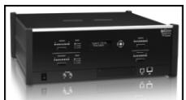
Summit T3-16 Protocol Analyzer

<table style="border:1px solid #ddd;border-collapse:collapse;width:100%" cellpadding="4" cellspacing="0" rules="all" frame="border">
<tr>
<td width="50%" style="border:1px solid #ddd;">
Summit T3-16 Protocol Analyzer
</td>
<td width="50%" style="border:1px solid #ddd;background-color:#e8e8e8">
Summit T3-16 协议分析仪
</td>
</tr>
</table>

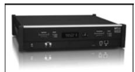
Summit T3-8 Protocol Analyzer

<table style="border:1px solid #ddd;border-collapse:collapse;width:100%" cellpadding="4" cellspacing="0" rules="all" frame="border">
<tr>
<td width="50%" style="border:1px solid #ddd;">
Summit T3-8 Protocol Analyzer
</td>
<td width="50%" style="border:1px solid #ddd;background-color:#e8e8e8">
Summit T3-8 协议分析仪
</td>
</tr>
</table>

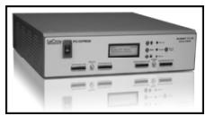
Summit T2-16 Protocol Analyzer

<table style="border:1px solid #ddd;border-collapse:collapse;width:100%" cellpadding="4" cellspacing="0" rules="all" frame="border">
<tr>
<td width="50%" style="border:1px solid #ddd;">
Summit T2-16 Protocol Analyzer
</td>
<td width="50%" style="border:1px solid #ddd;background-color:#e8e8e8">
Summit T2-16 协议分析仪
</td>
</tr>
</table>

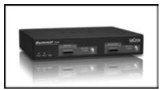
Summit T28 Protocol Analyzer

<table style="border:1px solid #ddd;border-collapse:collapse;width:100%" cellpadding="4" cellspacing="0" rules="all" frame="border">
<tr>
<td width="50%" style="border:1px solid #ddd;">
Summit T28 Protocol Analyzer
</td>
<td width="50%" style="border:1px solid #ddd;background-color:#e8e8e8">
Summit T28 协议分析仪
</td>
</tr>
</table>

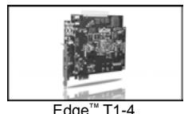
Edge T1-4 Protocol Analyzer

<table style="border:1px solid #ddd;border-collapse:collapse;width:100%" cellpadding="4" cellspacing="0" rules="all" frame="border">
<tr>
<td width="50%" style="border:1px solid #ddd;">
Edge T1-4 Protocol Analyzer
</td>
<td width="50%" style="border:1px solid #ddd;background-color:#e8e8e8">
Edge T1-4 协议分析仪
</td>
</tr>
</table>

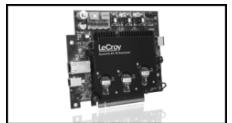

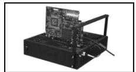
Summit Z3-16 Device Emulator
Summit Z3-16 Host Emulator

<table style="border:1px solid #ddd;border-collapse:collapse;width:100%" cellpadding="4" cellspacing="0" rules="all" frame="border">
<tr>
<td width="50%" style="border:1px solid #ddd;">
Summit Z3-16 Device Emulator / Summit Z3-16 Host Emulator
</td>
<td width="50%" style="border:1px solid #ddd;background-color:#e8e8e8">
Summit Z3-16 设备仿真器 / Summit Z3-16 主机仿真器
</td>
</tr>
</table>

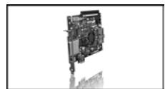

Gen2 Protocol Test Card

<table style="border:1px solid #ddd;border-collapse:collapse;width:100%" cellpadding="4" cellspacing="0" rules="all" frame="border">
<tr>
<td width="50%" style="border:1px solid #ddd;">
Gen2 Protocol Test Card
</td>
<td width="50%" style="border:1px solid #ddd;background-color:#e8e8e8">
Gen2 协议测试卡
</td>
</tr>
</table>

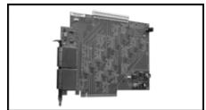
SimPASS PE Simulation Analysis
Gen3 x16 Active Interposer

<table style="border:1px solid #ddd;border-collapse:collapse;width:100%" cellpadding="4" cellspacing="0" rules="all" frame="border">
<tr>
<td width="50%" style="border:1px solid #ddd;">
SimPASS PE Simulation Analysis / Gen3 x16 Active Interposer
</td>
<td width="50%" style="border:1px solid #ddd;background-color:#e8e8e8">
SimPASS PE 仿真分析 / Gen3 x16 有源转接板
</td>
</tr>
</table>

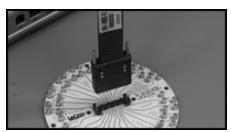
MidBus Probe

<table style="border:1px solid #ddd;border-collapse:collapse;width:100%" cellpadding="4" cellspacing="0" rules="all" frame="border">
<tr>
<td width="50%" style="border:1px solid #ddd;">
MidBus Probe
</td>
<td width="50%" style="border:1px solid #ddd;background-color:#e8e8e8">
总线中间探头
</td>
</tr>
</table>

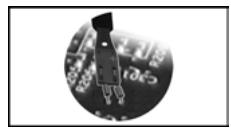
Multi-lead Probe

<table style="border:1px solid #ddd;border-collapse:collapse;width:100%" cellpadding="4" cellspacing="0" rules="all" frame="border">
<tr>
<td width="50%" style="border:1px solid #ddd;">
Multi-lead Probe
</td>
<td width="50%" style="border:1px solid #ddd;background-color:#e8e8e8">
多引线探头
</td>
</tr>
</table>

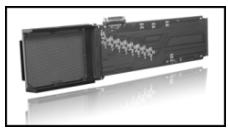
AMC Interposer

<table style="border:1px solid #ddd;border-collapse:collapse;width:100%" cellpadding="4" cellspacing="0" rules="all" frame="border">
<tr>
<td width="50%" style="border:1px solid #ddd;">
AMC Interposer
</td>
<td width="50%" style="border:1px solid #ddd;background-color:#e8e8e8">
AMC 转接板
</td>
</tr>
</table>

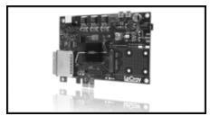
MiniCard Interposer

<table style="border:1px solid #ddd;border-collapse:collapse;width:100%" cellpadding="4" cellspacing="0" rules="all" frame="border">
<tr>
<td width="50%" style="border:1px solid #ddd;">
MiniCard Interposer
</td>
<td width="50%" style="border:1px solid #ddd;background-color:#e8e8e8">
MiniCard 转接板
</td>
</tr>
</table>

<table style="border:1px solid #ddd;border-collapse:collapse;width:100%" cellpadding="4" cellspacing="0" rules="all" frame="border">
<tr>
<td width="50%" style="border:1px solid #ddd;">
For many additional PCIe products and specialty probes, contact your local LeCroy representative or visit our website.
</td>
<td width="50%" style="border:1px solid #ddd;background-color:#e8e8e8">
如需了解更多 PCIe 产品和专业探头，请联系您当地的 LeCroy 代表或访问我们的网站。
</td>
</tr>
</table>

<table style="border:1px solid #ddd;border-collapse:collapse;width:100%" cellpadding="4" cellspacing="0" rules="all" frame="border">
<tr>
<td width="50%" style="border:1px solid #ddd;">
For more information on LeCroy protocol verification solutions, please contact your Regional Sales Engineer: 1-800-909-7211 or 408-653-1262; or PSGsales@lecroy.com
</td>
<td width="50%" style="border:1px solid #ddd;background-color:#e8e8e8">
如需了解更多关于 LeCroy 协议验证解决方案的信息，请联系您所在地区的销售工程师：1-800-909-7211 或 408-653-1262；或发送邮件至 PSGsales@lecroy.com
</td>
</tr>
</table>

## MindShare Live Training and Self-Paced Training | MindShare 现场培训和自学培训

<table style="border:1px solid #ddd;border-collapse:collapse;width:100%" cellpadding="4" cellspacing="0" rules="all" frame="border"><tr><td>Intel ArchitectureIntel Ivy Bridge ProcessorIntel 64 (x86) ArchitectureIntel QuickPath Interconnect (QPI)Computer Architecture</td><td>Virtualization TechnologyPC VirtualizationIO Virtualization</td></tr><tr><td>AMD ArchitectureAMD Opteron Processor (Bulldozer)AMD64 Architecture</td><td>IO BusesPCI Express 3.0USB 3.0 / 2.0xHCI for USB</td></tr><tr><td>Firmware TechnologyUEFI ArchitectureBIOS Essentials</td><td>Storage TechnologySAS ArchitectureSerial ATA ArchitectureNVMe Architecture</td></tr><tr><td>ARM ArchitectureARM Architecture</td><td>Memory TechnologyModern DRAM Architecture</td></tr><tr><td>Graphics ArchitectureGraphics Hardware Architecture</td><td>High Speed DesignHigh Speed DesignEMI/EMC</td></tr><tr><td>ProgrammingX86 Architecture ProgrammingX86 Assembly Language BasicsOpenCL Programming</td><td>Surface-Mount Technology (SMT)SMT ManufacturingSMT Testing</td></tr></table>

<table style="border:1px solid #ddd;border-collapse:collapse;width:100%" cellpadding="4" cellspacing="0" rules="all" frame="border">
<tr>
<td width="50%" style="border:1px solid #ddd;">
Are your company's technical training needs being addressed in the most effective manner? MindShare has over 25 years experience in conducting technical training on cutting-edge technologies. We understand the challenges companies have when searching for quality, effective training which reduces the students' time away from work and provides cost-effective alternatives. MindShare offers many flexible solutions to meet those needs. Our courses are taught by highly-skilled, enthusiastic, knowledgeable and experienced instructors. We bring life to knowledge through a wide variety of learning methods and delivery options.
</td>
<td width="50%" style="border:1px solid #ddd;background-color:#e8e8e8">
贵公司的技术培训需求是否得到了最有效的满足？MindShare 在尖端技术培训领域拥有超过 25 年的经验。我们理解公司在寻找优质、有效的培训时所面临的挑战，这些培训既要减少学员离开工作的时间，又要提供经济高效的替代方案。MindShare 提供多种灵活的解决方案来满足这些需求。我们的课程由技术精湛、充满热情、知识渊博且经验丰富的讲师授课。我们通过多种多样的学习方式和交付选项让知识变得生动起来。
</td>
</tr>
</table>

<table style="border:1px solid #ddd;border-collapse:collapse;width:100%" cellpadding="4" cellspacing="0" rules="all" frame="border">
<tr>
<td width="50%" style="border:1px solid #ddd;">
MindShare offers numerous courses in a self-paced training format (eLearning). We've taken our 25+ years of experience in the technical training industry and made that knowledge available to you at the click of a mouse.
</td>
<td width="50%" style="border:1px solid #ddd;background-color:#e8e8e8">
MindShare 提供多种自学培训格式（电子学习）的课程。我们将 25 年以上的技术培训行业经验汇聚起来，让您只需点击鼠标即可获取这些知识。
</td>
</tr>
</table>

<table style="border:1px solid #ddd;border-collapse:collapse;width:100%" cellpadding="4" cellspacing="0" rules="all" frame="border">
<tr>
<td width="50%" style="border:1px solid #ddd;">
MindShare Arbor is a computer system debug, validation, analysis and learning tool that allows the user to read and write any memory, IO or configuration space address. The data from these address spaces can be viewed in a clean and informative style as well as checked for configuration errors and non-optimal settings.
</td>
<td width="50%" style="border:1px solid #ddd;background-color:#e8e8e8">
MindShare Arbor 是一款计算机系统调试、验证、分析和学习工具，允许用户读取和写入任何内存、IO 或配置空间地址。来自这些地址空间的数据可以以清晰且信息丰富的方式查看，并检查配置错误和非最佳设置。
</td>
</tr>
</table>

## View Reference Info | 查看参考信息

<table style="border:1px solid #ddd;border-collapse:collapse;width:100%" cellpadding="4" cellspacing="0" rules="all" frame="border">
<tr>
<td width="50%" style="border:1px solid #ddd;">
MindShare Arbor is an excellent reference tool to quickly look at standard PCI, PCI-X and PCIe structures. All the register and field definitions are up-to-date with the PCI Express 3.0. x86, ACPI and USB reference info will be coming soon as well.
</td>
<td width="50%" style="border:1px solid #ddd;background-color:#e8e8e8">
MindShare Arbor 是一款优秀的参考工具，可快速查看标准 PCI、PCI-X 和 PCIe 结构。所有寄存器与字段定义均与 PCI Express 3.0 保持同步。x86、ACPI 和 USB 参考信息也将很快推出。
</td>
</tr>
</table>

## Decoding Standard and Custom Structures from a Live System | 从活动系统中解码标准与自定义结构

<table style="border:1px solid #ddd;border-collapse:collapse;width:100%" cellpadding="4" cellspacing="0" rules="all" frame="border">
<tr>
<td width="50%" style="border:1px solid #ddd;">
MindShare Arbor can perform a scan of the system it is running on to record the config space from all PCI-visible functions and show it in a clean and intuitive decoded format. In addition to scanning PCI config space, MindShare Arbor can also be directed to read any memory address space and IO address space and display the collected data in the same decoded fashion.
</td>
<td width="50%" style="border:1px solid #ddd;background-color:#e8e8e8">
MindShare Arbor 可以对其运行的系统执行扫描，以记录所有 PCI 可见功能的配置空间，并以清晰直观的解码格式显示。除了扫描 PCI 配置空间外，MindShare Arbor 还可以被指示读取任何内存地址空间和 IO 地址空间，并以相同的解码方式显示收集到的数据。
</td>
</tr>
</table>

## Run Rule Checks of Standard and Custom Structures | 运行标准和自定义结构的规则检查

<table style="border:1px solid #ddd;border-collapse:collapse;width:100%" cellpadding="4" cellspacing="0" rules="all" frame="border">
<tr>
<td width="50%" style="border:1px solid #ddd;">
In addition to capturing and displaying headers and capability structures from PCI config space, Arbor can also check the settings of each field for errors (e.g. violates the spec) and non-optimal values (e.g. a PCIe link trained to something less than its max capability). MindShare Arbor has scores of these checks built in and can be run on any system scan (live or saved). Any errors or warnings are flagged and displayed for easy evaluation and debugging. MindShare Arbor allows users to create their own rule checks to be applied to system scans. These rule checks can be for any structure, or set of structures, in PCI config space, memory space or IO space. The rule checks are written in JavaScript. (Python support coming soon.)
</td>
<td width="50%" style="border:1px solid #ddd;background-color:#e8e8e8">
除了从 PCI 配置空间中捕获和显示头部和能力结构之外，Arbor 还可以检查每个字段的设置是否存在错误（例如违反规范）和非最优值（例如 PCIe 链路训练到的速率低于其最大能力）。MindShare Arbor 内置了数十种此类检查，并可在任何系统扫描（实时或已保存）上运行。任何错误或警告都会被标记并显示出来，便于评估和调试。MindShare Arbor 允许用户创建自己的规则检查，并将其应用于系统扫描。这些规则检查可以针对 PCI 配置空间、内存空间或 I/O 空间中的任何结构或结构集。规则检查使用 JavaScript 编写。（即将支持 Python。）
</td>
</tr>
</table>

## Write Capability | 写入能力

<table style="border:1px solid #ddd;border-collapse:collapse;width:100%" cellpadding="4" cellspacing="0" rules="all" frame="border">
<tr>
<td width="50%" style="border:1px solid #ddd;">
MindShare Arbor provides a very simple interface to directly edit a register in PCI config space, memory address space or IO address space. This can be done in the decoded view so you see what the meaning of each bit, or by simply writing a hex value to the target location.
</td>
<td width="50%" style="border:1px solid #ddd;background-color:#e8e8e8">
MindShare Arbor 提供了一个非常简单的接口，可以直接编辑 PCI 配置空间、内存地址空间或 IO 地址空间中的寄存器。这可以在解码视图中完成，以便您查看每个位的含义，或者通过简单地写入十六进制值到目标位置。
</td>
</tr>
</table>

## Saving System Scans (XML) | 保存系统扫描（XML）

<table style="border:1px solid #ddd;border-collapse:collapse;width:100%" cellpadding="4" cellspacing="0" rules="all" frame="border">
<tr>
<td width="50%" style="border:1px solid #ddd;">
After a system scan has been performed, MindShare Arbor allows saving of that system's scanned data (PCI config space, memory space and IO space) all in a single file to be looked at later or sent to a colleague. The scanned data in these Arbor system scan files (.ARBSYS files) are XML-based and can be looked at with any text editor or web browser. Even scans performed with other tools can be easily converted to the Arbor XML format and evaluated with MindShare Arbor.
</td>
<td width="50%" style="border:1px solid #ddd;background-color:#e8e8e8">
在执行系统扫描后，MindShare Arbor 允许将该系统的扫描数据（PCI 配置空间、内存空间和 IO 空间）全部保存到一个文件中，以便日后查看或发送给同事。这些 Arbor 系统扫描文件（.ARBSYS 文件）中的扫描数据基于 XML，可以使用任何文本编辑器或 Web 浏览器查看。即使使用其他工具执行的扫描，也可以轻松转换为 Arbor XML 格式，并使用 MindShare Arbor 进行评估。
</td>
</tr>
</table>

## The Ultimate Tool to View, Edit and Verify Configuration Settings of a Computer | 查看、编辑和验证计算机配置设置的终极工具

<table style="border:1px solid #ddd;border-collapse:collapse;width:100%" cellpadding="4" cellspacing="0" rules="all" frame="border">
<tr>
<td width="50%" style="border:1px solid #ddd;">
The Ultimate Tool to View, Edit and Verify Configuration Settings of a Computer
</td>
<td width="50%" style="border:1px solid #ddd;background-color:#e8e8e8">
查看、编辑和验证计算机配置设置的终极工具
</td>
</tr>
</table>

## Feature List | 功能列表

<table style="border:1px solid #ddd;border-collapse:collapse;width:100%" cellpadding="4" cellspacing="0" rules="all" frame="border">
<tr>
<td width="50%" style="border:1px solid #ddd;">
Scan config space for all PCI-visible functions in system
</td>
<td width="50%" style="border:1px solid #ddd;background-color:#e8e8e8">
扫描系统中所有 PCI 可见功能的配置空间
</td>
</tr>
</table>

<table style="border:1px solid #ddd;border-collapse:collapse;width:100%" cellpadding="4" cellspacing="0" rules="all" frame="border">
<tr>
<td width="50%" style="border:1px solid #ddd;">
Run standard and custom rule checks to find errors and non-optimal settings
</td>
<td width="50%" style="border:1px solid #ddd;background-color:#e8e8e8">
运行标准和自定义规则检查，查找错误和非最佳设置
</td>
</tr>
</table>

<table style="border:1px solid #ddd;border-collapse:collapse;width:100%" cellpadding="4" cellspacing="0" rules="all" frame="border">
<tr>
<td width="50%" style="border:1px solid #ddd;">
Write to any config space location, memory address or IO address
</td>
<td width="50%" style="border:1px solid #ddd;background-color:#e8e8e8">
写入任意配置空间位置、内存地址或 IO 地址
</td>
</tr>
</table>

<table style="border:1px solid #ddd;border-collapse:collapse;width:100%" cellpadding="4" cellspacing="0" rules="all" frame="border">
<tr>
<td width="50%" style="border:1px solid #ddd;">
View standard and non-standard structures in a decoded format
</td>
<td width="50%" style="border:1px solid #ddd;background-color:#e8e8e8">
以解码格式查看标准和非标准结构
</td>
</tr>
</table>

<table style="border:1px solid #ddd;border-collapse:collapse;width:100%" cellpadding="4" cellspacing="0" rules="all" frame="border">
<tr>
<td width="50%" style="border:1px solid #ddd;">
Import raw scan data from other tools (e.g. lspci) to view in Arbor's decoded format
</td>
<td width="50%" style="border:1px solid #ddd;background-color:#e8e8e8">
从其他工具（如 lspci）导入原始扫描数据，在 Arbor 的解码格式中查看
</td>
</tr>
</table>

<table style="border:1px solid #ddd;border-collapse:collapse;width:100%" cellpadding="4" cellspacing="0" rules="all" frame="border">
<tr>
<td width="50%" style="border:1px solid #ddd;">
Decode info included for standard PCI, PCI-X and PCI Express structures
</td>
<td width="50%" style="border:1px solid #ddd;background-color:#e8e8e8">
包含标准 PCI、PCI-X 和 PCI Express 结构的解码信息
</td>
</tr>
</table>

<table style="border:1px solid #ddd;border-collapse:collapse;width:100%" cellpadding="4" cellspacing="0" rules="all" frame="border">
<tr>
<td width="50%" style="border:1px solid #ddd;">
Decode info included for some x86-based structures and device-specific registers
</td>
<td width="50%" style="border:1px solid #ddd;background-color:#e8e8e8">
包含部分基于 x86 的结构和设备特定寄存器的解码信息
</td>
</tr>
</table>

<table style="border:1px solid #ddd;border-collapse:collapse;width:100%" cellpadding="4" cellspacing="0" rules="all" frame="border">
<tr>
<td width="50%" style="border:1px solid #ddd;">
Create decode files for structures in config space, memory address space and IO space
</td>
<td width="50%" style="border:1px solid #ddd;background-color:#e8e8e8">
为配置空间、内存地址空间和 IO 空间中的结构创建解码文件
</td>
</tr>
</table>

<table style="border:1px solid #ddd;border-collapse:collapse;width:100%" cellpadding="4" cellspacing="0" rules="all" frame="border">
<tr>
<td width="50%" style="border:1px solid #ddd;">
Save system scans for viewing later or on other systems
</td>
<td width="50%" style="border:1px solid #ddd;background-color:#e8e8e8">
保存系统扫描以供稍后或在其他系统上查看
</td>
</tr>
</table>

<table style="border:1px solid #ddd;border-collapse:collapse;width:100%" cellpadding="4" cellspacing="0" rules="all" frame="border">
<tr>
<td width="50%" style="border:1px solid #ddd;">
All decode files and saved system scans are XML-based and open-format
</td>
<td width="50%" style="border:1px solid #ddd;background-color:#e8e8e8">
所有解码文件和保存的系统扫描均基于 XML 且为开放格式
</td>
</tr>
</table>

## COMING SOON | 即将推出

<table style="border:1px solid #ddd;border-collapse:collapse;width:100%" cellpadding="4" cellspacing="0" rules="all" frame="border">
<tr>
<td width="50%" style="border:1px solid #ddd;">
Decoded view of x86 structures (MSRs, ACPI, Paging, Virtualization, etc.)
</td>
<td width="50%" style="border:1px solid #ddd;background-color:#e8e8e8">
x86 结构（MSR、ACPI、分页、虚拟化等）的解码视图
</td>
</tr>
</table>
